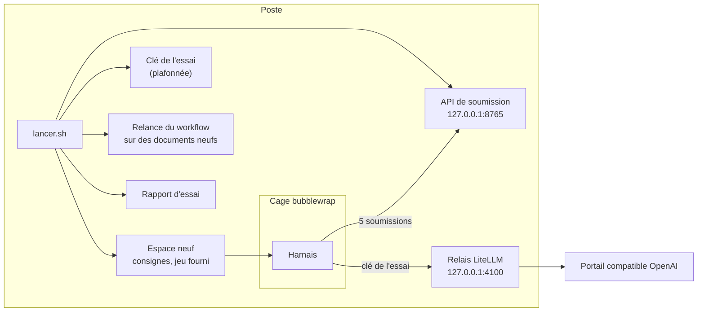

# Banc d'essai

Tout ce qu'il faut pour faire passer un harnais d'agent sur une tâche d'extraction, isolé, mesuré et noté, puis comparer les harnais entre eux. Les harnais eux-mêmes sont dans [`harnais/`](../harnais/README.md).

## Comment se déroule un essai



1. Le lanceur prépare un espace neuf (consignes, documents fournis avec leurs réponses), crée une clé du modèle propre à l'essai et démarre l'API de soumission.
2. Le harnais, dans la cage, construit un workflow d'extraction, le soumet au plus 5 fois sur un test caché, puis déclare sa fin avec la commande de son workflow.
3. Le lanceur supprime la clé, relance ce workflow sans le harnais sur des documents jamais vus, collecte les traces et écrit le rapport.

| Jeu du goldset | Rôle dans un essai |
|---|---|
| `train` | jeu fourni au harnais, avec les réponses |
| `val` | test caché, noté par l'API |
| `test` | relance du workflow livré : note de référence |

## Contenu

| Dossier ou fichier | Rôle | Documentation |
|---|---|---|
| `modele.env` | modèle servi aux harnais : nom, contexte, vision, prix, plafond | [modele-et-fournisseur.md](documentation/modele-et-fournisseur.md) |
| `traces/` | relais LiteLLM vers le portail, clés d'essai, journal de chaque appel, vérificateur du portail | [traces/README.md](traces/README.md) |
| `cage/` | lanceur d'essai, cage bubblewrap, filtre réseau, collecte, sonde de preuve | [cage/README.md](cage/README.md), [lancer-un-essai.md](documentation/lancer-un-essai.md) |
| `evaluation/` | API de soumission, notation, préparation de l'espace, relance, rapports, tests | [evaluation/README.md](evaluation/README.md) |
| `corpus/` | import du goldset de l'équipe, consignes, démonstration sur 35 rapports fictifs | [corpus/README.md](corpus/README.md), [goldset.md](documentation/goldset.md) |
| `recettes/` | consignes de la tâche jouet, modèle des consignes du goldset | |
| `resultats/` | essais de la tâche jouet et de la sonde (créé au premier essai) | |
| `resultats-goldset/` | un dossier par essai sur le goldset (jamais versionné) | |
| `documentation/` | pages détaillées : modèle, goldset, essais, sécurité | [documentation/README.md](documentation/README.md) |

## Tâches et recettes

| Recette | Tâche | Ce qui est mesuré |
|---|---|---|
| `jouet` | petit paquet Python noté par des tests cachés | que le harnais tourne dans la cage, de bout en bout (quelques minutes) |
| `goldset` | les champs du goldset importé (PDF de l'équipe et leurs réponses) | la tâche réelle |

## Commandes essentielles

Depuis la racine du dépôt :

```bash
banc-essai/traces/demarrer.sh                         # démarrer le relais du modèle
python3 banc-essai/traces/verifier_portail.py         # vérifier le portail
banc-essai/cage/lancer.sh sonde jouet                 # prouver la cage (42 vérifications)
banc-essai/cage/lancer.sh <harnais> jouet             # premier essai d'un harnais
python3 banc-essai/corpus/importer_goldset.py         # importer un goldset
python3 banc-essai/corpus/consignes_goldset.py        # consignes du goldset (schéma validé)
banc-essai/cage/lancer.sh <harnais> goldset           # essai sur le goldset
python3 banc-essai/cage/suivi.py <essai>              # suivre un essai
uv run --project banc-essai/evaluation pytest         # tests automatiques du banc
```

## Règles du banc

| Règle | Raison |
|---|---|
| un seul essai à la fois sur la machine | mesures non perturbées, une seule API de soumission |
| aucun harnais ne voit la clé du portail | une clé plafonnée par essai, supprimée à la fin |
| le test caché et la relance ne sont jamais visibles du harnais | sinon la note ne mesure plus rien |
| les données du goldset ne sont jamais versionnées | dépôt public ; garde-fous dans [securite-et-donnees.md](documentation/securite-et-donnees.md) |
