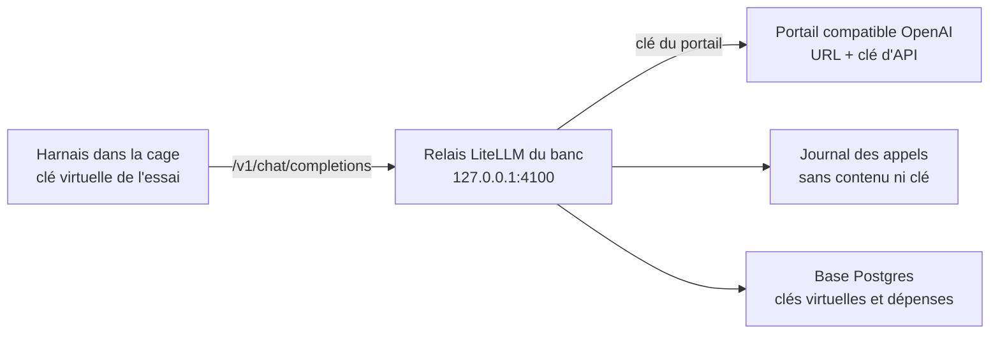

# Brancher le banc sur un autre point d'accès compatible OpenAI

Ce guide explique comment remplacer OpenRouter par un autre fournisseur de modèle qui expose une API compatible OpenAI. Il vise en particulier un portail d'entreprise qui fournit une adresse (URL) et une clé d'API. Il couvre la configuration et la sécurité du banc, pas la tâche ni la notation.

En bref :

- seul le relais (LiteLLM du banc) parle au fournisseur. Les harnais, la cage et l'évaluation ne changent pas ;
- 5 fichiers sont à modifier (section 4). Aucun ne demande d'écrire du code nouveau ;
- la vraie clé du portail reste dans le relais. Chaque essai reçoit une clé virtuelle jetable, plafonnée et limitée à l'appel du modèle ;
- avant tout essai réel, 4 vérifications (section 6), dont une sans aucune dépense grâce à un faux portail local.

Tout ce qui est affirmé ici a été vérifié le 20/11/2026 avec LiteLLM v1.106.4, l'image utilisée par le banc :

- un relais déclaré en mode « compatible OpenAI générique » a appelé OpenRouter comme s'il s'agissait d'un portail quelconque. La réponse a été obtenue et le coût calculé ;
- le même relais, pointé sur un faux portail local, a montré ce qu'il transmet. C'est la section 6.

## 1. Principe : un seul point de contact avec le fournisseur



| Élément | Ce qu'il connaît | Ce qu'il ne connaît jamais |
|---|---|---|
| Harnais (dans la cage) | l'adresse du relais (`BANC_MODELE_URL`), le nom du modèle exposé (`BANC_MODELE`), sa clé virtuelle (`BANC_CLE_MODELE`) | l'adresse du portail, la clé du portail, la clé maître du relais |
| Relais LiteLLM | la clé du portail, la clé maître, les prix déclarés | rien du reste de `.env` |
| Portail | la clé du portail, le nom réel du modèle, le contenu des requêtes | les clés virtuelles, le harnais utilisé |

Pourquoi passer par ce relais plutôt que donner l'adresse du portail aux harnais :

| Besoin | Sans relais | Avec le relais du banc |
|---|---|---|
| Clé exposée au harnais | la vraie clé du portail | une clé virtuelle, supprimée à la fin de l'essai |
| Plafond par essai | aucun, ou celui du portail pour toute l'équipe | `max_budget` par clé (2 $ dans le banc) |
| Mesure de chaque appel | selon le harnais, rarement complète | une ligne par appel dans `journaux/appels.jsonl`, identique pour tous les harnais |
| Changement de fournisseur | 5 configurations de harnais à reprendre | 1 fichier de configuration du relais |
| Accès réseau de la cage | sortie vers le portail à ouvrir | aucune sortie : la cage ne voit que le relais local |

## 2. Ce qu'il faut obtenir du portail avant de commencer

| Information | Pourquoi le banc en a besoin | Comment la vérifier |
|---|---|---|
| URL de base de l'API | `api_base` du relais | se termine en général par `/v1` ; `curl <URL>/models` répond (section 6) |
| Clé d'API | `api_key` du relais | un appel de test réussit ; une clé fausse donne 401 |
| Nom exact du modèle | `model: openai/<nom>` du relais | liste renvoyée par `GET <URL>/models` |
| Route `/chat/completions` | les 5 harnais du banc l'utilisent | appel de test (section 6, étape 3) |
| Appel d'outils (« function calling », champ `tools`) | indispensable : un harnais agit par des outils (lire, écrire, exécuter) | tâche jouet (section 6, étape 4) ; un modèle sans outils fait échouer tous les harnais |
| Images en entrée | la tâche d'extraction peut être lue par la vision | sonde du banc, contrôle « appel avec image » |
| Réponse en flux (`stream: true`) | plusieurs harnais l'emploient | tâche jouet ; en cas d'échec, voir la section 8 |
| Taille de contexte et sortie maximale | les harnais envoient de longues conversations | documentation du portail |
| Limites de débit (requêtes et jetons par minute) | un essai fait 300 à 600 appels en 25 à 35 min | documentation du portail ; les erreurs 429 sont comptées par le banc |
| Mode de facturation ou quota | régler le plafond par essai (section 5) | documentation du portail |
| Certificat de l'autorité interne | appels HTTPS refusés sinon (`CERTIFICATE_VERIFY_FAILED`) | service informatique ; fichier `.pem` |
| Mandataire (proxy) HTTP sortant | le relais doit passer par lui pour joindre le portail | service informatique ; variables `HTTPS_PROXY` du poste |
| En-têtes supplémentaires exigés | certains portails demandent un identifiant d'application ou de projet | documentation du portail |
| Règles sur les données envoyées | les documents de la tâche partent au portail | politique de l'entreprise : niveau de sensibilité autorisé, conservation des requêtes par le portail |

## 3. Ce qui change, ce qui ne change pas

| Partie du banc | Change | Détail |
|---|---|---|
| `.env` (racine, hors git) | oui | nouvelles variables du portail (section 4.1) |
| `banc-essai/traces/demarrer.sh` | oui | recopie la clé du portail au lieu de la clé OpenRouter (4.2) |
| `banc-essai/traces/config.yaml` | oui | déclaration du modèle et des prix (4.3) |
| `banc-essai/traces/docker-compose.yml` | seulement si certificat interne ou mandataire | (4.4) |
| `banc-essai/traces/cles.py` et `banc-essai/cage/cage.sh` | seulement si le nom exposé du modèle change | (4.5) |
| `banc-essai/cage/sonde/sonde.py` | recommandé | contrôles adaptés au nouveau fournisseur (4.6) |
| Harnais (`harnais/*/configurer.sh`) | non | ils lisent `BANC_MODELE_URL` et `BANC_MODELE`, qui désignent le relais |
| Cage, mandataire PyPI, évaluation, notation, relance | non | indépendants du fournisseur |
| Journal des appels | non | le champ `cout_openrouter` reste vide : il n'est rempli que par OpenRouter |

## 4. Mise en place, fichier par fichier

### 4.1 `.env`

Deux lignes, à la racine du dépôt. Le fichier est exclu de git (`.gitignore`) et ne doit jamais être affiché :

```bash
PORTAIL_URL=https://portail.exemple.interne/v1
PORTAIL_API_KEY=<clé fournie par le portail>
```

Ne pas nommer la clé `OPENAI_API_KEY`. LiteLLM offre des routes de transfert direct (par exemple `/openai/...`) qui utilisent la clé du fournisseur trouvée sous ce nom dans l'environnement. Le banc donne donc à la clé un nom qui lui est propre.

### 4.2 `banc-essai/traces/demarrer.sh`

Remplacer la vérification et la recopie de la clé OpenRouter par celles du portail. Le principe ne change pas : le fichier `secrets/fournisseur.env` (droits 600, hors git) reçoit ces deux lignes et rien d'autre du `.env`.

```bash
grep -q '^PORTAIL_API_KEY=.' ../../.env || { echo "PORTAIL_API_KEY absente de .env" >&2; exit 1; }
grep -E '^PORTAIL_(URL|API_KEY)=' ../../.env \
  | sed -e 's/^PORTAIL_URL=/BANC_PORTAIL_URL=/' -e 's/^PORTAIL_API_KEY=/BANC_PORTAIL_KEY=/' \
  > secrets/fournisseur.env
```

### 4.3 `banc-essai/traces/config.yaml`

Seule l'entrée du modèle change. Les réglages généraux restent :

- `callbacks: journal_appels.journal` : journal des appels ;
- `master_key` et `database_url` : clés virtuelles ;
- `proxy_batch_write_at: 1` : dépense relue à la fin de l'essai ;
- `disable_cooldowns` et `num_retries: 0` : le harnais reçoit les vraies erreurs, sans nouvelle tentative cachée.

```yaml
model_list:
  - model_name: modele-banc                    # nom vu par les harnais (BANC_MODELE)
    litellm_params:
      model: openai/<nom exact du modèle sur le portail>
      api_base: os.environ/BANC_PORTAIL_URL    # avec le /v1 final
      api_key: os.environ/BANC_PORTAIL_KEY
      # extra_headers:                         # seulement si le portail en exige
      #   X-Application: banc-harnais
      input_cost_per_token: 5.0e-08            # voir la section 5
      output_cost_per_token: 3.0e-07
```

| Clé | Rôle | Remarque |
|---|---|---|
| `model_name` | nom exposé aux harnais | libre ; le garder identique à `BANC_MODELE` (4.5) |
| `model: openai/...` | le préfixe `openai/` dit à LiteLLM d'appeler une API compatible OpenAI | le reste est le nom du modèle tel que le portail le connaît |
| `api_base` | adresse du portail | LiteLLM y ajoute `/chat/completions` : l'adresse doit contenir `/v1` si le portail l'attend, et rien après |
| `api_key` | clé du portail, lue dans l'environnement du conteneur | jamais écrite en clair dans ce fichier, qui est versionné |
| `extra_headers` | en-têtes ajoutés à chaque requête vers le portail | vérifié avec le faux portail (section 6) |
| `extra_body` de la configuration actuelle | choix du fournisseur et du rapport de coût chez OpenRouter | à supprimer : propre à OpenRouter |

### 4.4 `banc-essai/traces/docker-compose.yml` : certificat interne et mandataire

À ajouter au service `harness-litellm`, seulement si le réseau de l'entreprise l'exige :

```yaml
    environment:
      JOURNAL_APPELS: /journaux/appels.jsonl
      SSL_CERT_FILE: /certs/ac-entreprise.pem       # certificat de l'autorité interne
      HTTPS_PROXY: http://proxy.exemple.interne:8080
      HTTP_PROXY: http://proxy.exemple.interne:8080
      NO_PROXY: localhost,127.0.0.1,harness-litellm-db
      AIOHTTP_TRUST_ENV: "True"                     # fait lire HTTPS_PROXY par le client HTTP de LiteLLM
    volumes:
      - ./certs/ac-entreprise.pem:/certs/ac-entreprise.pem:ro
```

| Variable | Effet | Source |
|---|---|---|
| `SSL_CERT_FILE` | fichier de certificats de confiance utilisé par LiteLLM | documentation LiteLLM ; lue dans `http_handler.py` de la v1.106.4 |
| `SSL_VERIFY=False` | désactive la vérification du certificat | à ne pas utiliser : expose la clé à une interception |
| `HTTPS_PROXY`, `NO_PROXY` | mandataire sortant ; `NO_PROXY` doit contenir la base Postgres | documentation LiteLLM |
| `AIOHTTP_TRUST_ENV` | fait prendre en compte les variables de mandataire par le client HTTP asynchrone | lue dans `http_handler.py` de la v1.106.4 ; non essayé derrière un vrai mandataire : à confirmer par l'appel de test |

### 4.5 Nom du modèle exposé

Si `model_name` n'est plus `deepseek-v4.1-flash`, deux endroits portent ce nom :

| Fichier | Ligne actuelle | À mettre |
|---|---|---|
| `banc-essai/traces/cles.py` | `MODELES = ["deepseek-v4.1-flash"]` | `MODELES = ["modele-banc"]` : une clé virtuelle n'ouvre que ces modèles |
| `banc-essai/cage/cage.sh` | `--setenv BANC_MODELE deepseek-v4.1-flash` | `--setenv BANC_MODELE modele-banc` : nom transmis aux harnais |

### 4.6 Sonde de la cage (`banc-essai/cage/sonde/sonde.py`)

La sonde contrôle 42 points de la cage et du relais. Trois points citent OpenRouter et sont à adapter :

- remplacer `OPENROUTER_API_KEY` par `PORTAIL_API_KEY` dans le contrôle « clé absente de l'environnement » ;
- remplacer le nom `deepseek-v4.1-flash` écrit en dur dans le contrôle « fausse clé » par `os.environ["BANC_MODELE"]` ;
- ajouter `("GET", "/openai/v1/models", None)` à la liste des routes qui doivent être refusées avec la clé de l'essai.

## 5. Plafond de dépense par essai

LiteLLM ne bloque une clé virtuelle que s'il sait calculer un coût. Sans prix déclarés, chaque appel coûte 0 et le plafond ne bloque rien. La documentation de LiteLLM précise qu'un prix déclaré à 0 désactive le contrôle de budget.

| Situation du portail | Réglage recommandé | Effet |
|---|---|---|
| Prix au jeton connus | les déclarer (`input_cost_per_token`, `output_cost_per_token`, en dollars par jeton) | plafond en vraie monnaie, coût de chaque essai juste |
| Gratuit pour l'équipe, mais quota partagé | déclarer un prix conventionnel (par exemple celui d'un modèle public comparable) et l'écrire dans le protocole | le plafond devient un plafond de jetons : il protège le quota de l'équipe |
| Débit limité par le portail | en plus du budget, `rpm_limit` ou `tpm_limit` sur la clé virtuelle (`cles.py`, champs du corps de `/key/generate`) | un essai ne sature pas le quota des autres utilisateurs ; vérifié le 20/11/2026 : avec `rpm_limit: 2`, le 3e appel de la minute reçoit 429 |

Dans le banc, les prix sont déclarés sous `litellm_params`. Cette forme est vérifiée : le coût calculé correspondait à la facture d'OpenRouter. La documentation de LiteLLM présente aussi la forme sous `model_info`.

## 6. Vérifications, dans l'ordre

### Étape 1. Le portail répond, hors banc

À lancer depuis le poste, avec les variables chargées dans le shell sans les afficher :

```bash
set -a; . ./.env; set +a
curl -s "$PORTAIL_URL/models" -H "Authorization: Bearer $PORTAIL_API_KEY" | python3 -m json.tool | head -30
```

| Résultat | Signification |
|---|---|
| liste de modèles | URL, clé et certificat corrects ; noter le nom exact du modèle |
| 401 ou 403 | clé refusée |
| 404 | `/v1` manquant ou en trop dans l'URL |
| erreur de certificat | certificat interne à fournir (4.4) |
| délai dépassé | mandataire à déclarer (4.4) |

### Étape 2. Le relais transmet ce qu'il faut : faux portail, aucune dépense

`banc-essai/traces/faux_portail.py` imite un portail sur `127.0.0.1:4198`. Il affiche, pour chaque requête reçue du relais :

- le chemin appelé ;
- la présence d'une clé, jamais sa valeur ;
- les en-têtes `X-*` ;
- le modèle transmis ;
- les champs envoyés.

Mode opératoire :

1. Lancer `python3 banc-essai/traces/faux_portail.py`.
2. Démarrer un relais de test avec `api_base: http://127.0.0.1:4198/v1` et le réseau de l'hôte (`docker run --network host`).
3. Envoyer un appel au relais avec sa clé maître.

Résultat obtenu le 20/11/2026 avec LiteLLM v1.106.4 :

| Ce qui est envoyé au relais | Ce que le faux portail a reçu |
|---|---|
| `POST /v1/chat/completions` | `POST /v1/chat/completions` (`api_base` + `/chat/completions`) |
| `model: modele-banc` | `model: <nom déclaré après openai/>` |
| clé maître ou virtuelle du relais | `Authorization: Bearer <clé du portail>` : la clé du relais n'est jamais transmise |
| `tools` (1 outil) | `tools` transmis |
| aucun en-tête particulier | `X-Banc-Essai: generique`, ajouté par `extra_headers` |

### Étape 3. Un vrai appel par le relais du banc

Après `banc-essai/traces/demarrer.sh`, depuis la racine du dépôt :

```bash
M=$(grep '^LITELLM_MASTER_KEY=' banc-essai/traces/secrets/maitre.env | cut -d= -f2)
curl -s -D - -o /dev/null http://127.0.0.1:4100/v1/chat/completions \
  -H "Authorization: Bearer $M" -H 'Content-Type: application/json' \
  -d '{"model":"modele-banc","messages":[{"role":"user","content":"Réponds seulement OK"}],"max_tokens":20}' \
  | grep -i -e '^HTTP' -e 'x-litellm-response-cost:'
tail -1 banc-essai/traces/journaux/appels.jsonl
```

Attendu : `HTTP/1.1 200`, un coût non nul (sinon, prix non déclarés : section 5) et une ligne `"statut": "succes"` au journal.

Essai du 20/11/2026, avec OpenRouter appelé comme un portail générique (`openai/` + `api_base`) :

- réponse `OK` ;
- 34 jetons envoyés, 12 produits ;
- coût calculé 0,0000053 $.

### Étape 4. La cage et un harnais de bout en bout

```bash
banc-essai/cage/lancer.sh sonde jouet --essai preuve-portail --message "$PWD/banc-essai/corpus/test-cache"
banc-essai/cage/lancer.sh opencode jouet --essai portail-jouet-1
```

- La sonde doit être conforme sur tous ses points, ceux de la section 4.6 compris.
- La tâche jouet coûte environ 0,001 à 0,002 $ avec un modèle au prix de DeepSeek V4.1 Flash. Elle prouve que le modèle sait appeler des outils à travers un vrai harnais.
- Recommencer la tâche jouet avec chaque harnais avant une campagne.

## 7. Sécurité : ce que le banc protège et comment

| Risque | Parade dans le banc | Où |
|---|---|---|
| Clé du portail lue par un harnais | clé connue du seul conteneur du relais ; la cage ne reçoit que `BANC_CLE_MODELE` | `demarrer.sh`, `docker-compose.yml`, `cage.sh` (`--clearenv`) |
| Clé du portail utilisée par une route détournée du relais | nom propre au banc (`BANC_PORTAIL_KEY`), jamais `OPENAI_API_KEY` ; clé virtuelle limitée aux routes d'appel du modèle (`allowed_routes`) | `cles.py` (`ROUTES`), contrôles de la sonde |
| Clé virtuelle réutilisée après l'essai | une clé par essai, supprimée dès la sortie du harnais ; une autre pour la relance | `lancer.sh`, `cles.py --supprimer` |
| Clé affichée dans une trace (un harnais imprime son environnement) | masquage de toute chaîne `sk-…` avant commit ; la clé est déjà supprimée du relais | `masquer.py`, appelé par `lancer.sh` |
| Dépense incontrôlée | plafond par clé (`max_budget`), prix déclarés, limite posée aussi côté portail si possible | `cles.py` (`BUDGET`), `config.yaml` |
| Relais accessible depuis le réseau | ports liés à `127.0.0.1` seulement | `docker-compose.yml` (`127.0.0.1:4100:4000`) |
| Sortie de la cage vers Internet ou le réseau interne | aucun réseau dans la cage, sauf trois relais locaux : modèle, API de soumission, mandataire filtré (PyPI, Hugging Face, GitHub) | `cage.sh`, `relais.py` |
| Secrets versionnés | `.env`, `banc-essai/traces/secrets/` et `journaux/` exclus de git | `.gitignore` |
| Contenu des documents dans les journaux du banc | le journal ne garde que des comptes (jetons, durée, coût, nombre d'images), ni texte ni clé ; les messages d'erreur sont masqués | `journal_appels.py` |
| Interception de la connexion au portail | vérification du certificat maintenue (`SSL_CERT_FILE`, jamais `SSL_VERIFY=False`) | `docker-compose.yml` |
| Données sensibles envoyées au portail | corpus synthétique du banc (aucun document réel) ; vérifier que le portail accepte ce niveau de données | `banc-essai/corpus/` ; politique de l'entreprise |

Ce que le banc ne protège pas :

- la conservation des requêtes par le portail lui-même ;
- les quotas partagés avec d'autres utilisateurs du portail, à régler avec les administrateurs du portail.

## 8. Problèmes fréquents

| Symptôme | Cause probable | Correction |
|---|---|---|
| 404 `Not Found` à chaque appel | `api_base` sans `/v1`, ou avec un chemin en trop | `https://…/v1`, sans `/chat/completions` |
| 401 au relais | clé virtuelle supprimée ou fausse | normal après un essai ; en recréer une avec `cles.py` |
| 401 venant du portail | clé du portail absente du conteneur | vérifier les noms dans `secrets/fournisseur.env` et `config.yaml`, puis relancer `demarrer.sh` |
| `CERTIFICATE_VERIFY_FAILED` | autorité interne inconnue | `SSL_CERT_FILE` (4.4) |
| délai dépassé vers le portail | mandataire non déclaré | `HTTPS_PROXY` et `AIOHTTP_TRUST_ENV` (4.4) |
| coût 0 au journal, plafond inopérant | prix non déclarés | section 5 |
| 400 sur un paramètre inconnu | le harnais envoie un champ que le portail refuse | `drop_params: true` est déjà actif ; sinon noter le champ et le harnais |
| le harnais ne fait rien ou répond sans agir | modèle ou portail sans appel d'outils | vérifier `tools` avec le faux portail puis la tâche jouet ; changer de modèle |
| 429 nombreux | limite de débit du portail | les compter (mesure du banc) ; `rpm_limit` par clé ; un seul essai à la fois |
| le portail refuse le rôle `system` | modèle qui n'accepte pas les messages système | `supports_system_message: false` dans `litellm_params` (documentation LiteLLM) |

## Sources

- LiteLLM, points d'accès compatibles OpenAI (préfixe `openai/`, `api_base` avec `/v1`) : <https://docs.litellm.ai/docs/providers/openai_compatible>
- LiteLLM, certificats et mandataire (`SSL_CERT_FILE`, `ssl_verify`, `HTTPS_PROXY`, `NO_PROXY`) : <https://docs.litellm.ai/docs/guides/security_settings>
- LiteLLM, prix déclarés (`input_cost_per_token`, `output_cost_per_token` ; prix à 0 = pas de contrôle de budget) : <https://docs.litellm.ai/docs/proxy/custom_pricing>
- LiteLLM, clés virtuelles (`models`, `max_budget`, `allowed_routes`, `rpm_limit`, `tpm_limit`) : <https://docs.litellm.ai/docs/proxy/virtual_keys>
- Pages consultées le 20/11/2026.
- Essais réels du 20/11/2026 avec `ghcr.io/berriai/litellm:v1.106.4` :
  - appel générique vers OpenRouter ;
  - faux portail ;
  - lecture de `litellm/llms/custom_httpx/http_handler.py` pour `SSL_CERT_FILE` et `AIOHTTP_TRUST_ENV`.
- Configuration actuelle du relais : [banc-essai/traces/README.md](../banc-essai/traces/README.md).
