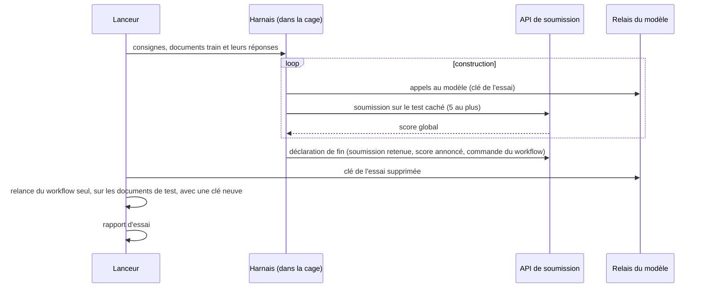

# Principe du banc

## Ce qui est comparé

Un **harnais d'agent** est le programme qui fait travailler un modèle d'IA : il lui donne des outils (lire et écrire des fichiers, lancer des commandes), enchaîne ses appels et gère sa mémoire de travail. Le banc compare plusieurs harnais **avec le même modèle**, servi par le même portail : les écarts mesurés viennent donc de la façon dont chaque harnais organise le travail, pas du modèle.

La tâche est celle de l'équipe : extraire des valeurs de documents PDF. Le harnais ne remplit pas lui-même les réponses une à une : il **construit un workflow** (un programme) qui lit un dossier de PDF et écrit un fichier JSON par document. C'est ce workflow qui est jugé, en particulier sur des documents qu'il n'a jamais vus.

## Déroulé d'un essai

| Jeu du goldset | Rôle | Vu par le harnais |
|---|---|---|
| `train` | construire le workflow : PDF et réponses attendues | oui |
| `val` | valider le workflow : PDF et réponses attendues | oui |
| `test` | test caché : le harnais y soumet ses réponses et ne reçoit qu'un score global ; après la fin de l'essai, le workflow livré y est relancé sans le harnais | PDF seulement, jamais les réponses |

## Ce que disent les mesures

| Mesure | Ce qu'elle dit |
|---|---|
| Score de relance | qualité du workflow livré, exécuté seul, sur les documents de test : la mesure principale |
| Documents entièrement justes | part des documents sans aucune erreur : plus sévère que le score par champ, et souvent plus discriminante |
| Score final au test caché | qualité de la soumission retenue par le harnais |
| Écart entre score annoncé et score réel | lucidité du harnais sur la qualité de son propre travail |
| Taux d'invention, d'omission | valeurs inventées là où rien n'était attendu ; valeurs manquées |
| Appels, jetons, durée de construction | coût pour obtenir le workflow |
| Coût et durée par document à la relance | coût d'exploitation du workflow |

Un écart de quelques points entre deux harnais sur un seul essai n'est pas une différence établie : il faut plusieurs passes pour séparer le hasard d'un vrai écart.

## Règles qui rendent la comparaison juste

| Règle | Raison |
|---|---|
| même modèle, mêmes consignes, mêmes ressources pour tous les harnais | seul le harnais varie |
| harnais isolé dans une cage : réseau limité au modèle, à l'API et aux dépôts de paquets | ni fuite de données, ni aide extérieure |
| test caché et relance jamais visibles du harnais | sinon la note ne mesure plus rien |
| clé du modèle propre à l'essai, plafonnée, supprimée à la fin | dépense bornée, workflow relancé sans la clé de construction |
| un seul essai à la fois sur le poste | mesures non perturbées |

## Vocabulaire

| Terme | Sens |
|---|---|
| goldset | jeu de documents avec, pour chacun, les valeurs attendues |
| schéma | description des champs à extraire et de la façon de noter chacun (`schema.json`), validée par l'équipe |
| recette | une tâche et ses consignes : `jouet` (mise au point d'un harnais) ou `goldset` |
| cage | environnement isolé (bubblewrap) où tourne le harnais |
| relais | serveur LiteLLM local qui transmet les appels au portail et tient le journal et les plafonds |
| portail | service compatible OpenAI qui sert le modèle (une adresse, une clé) |
| relance | exécution du workflow livré, sans le harnais, sur le jeu `test` |
