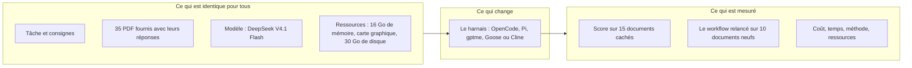
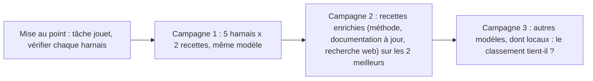
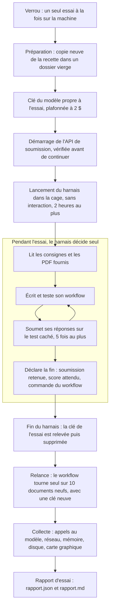
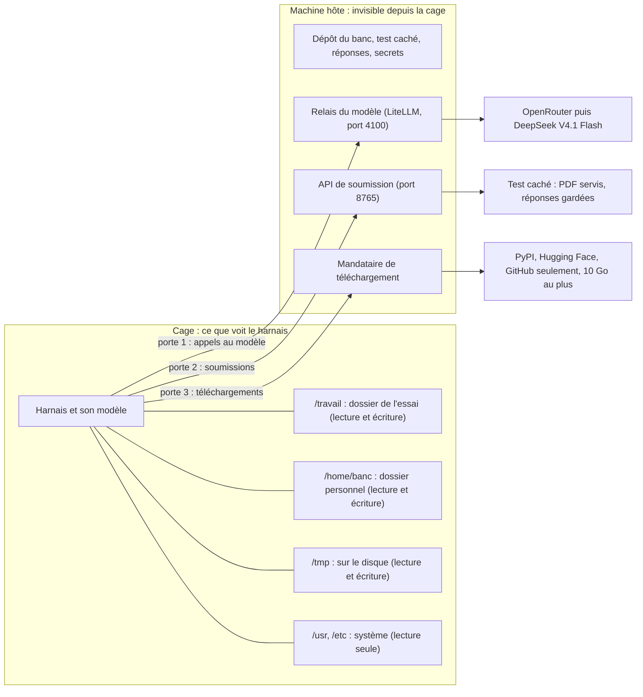

# Le protocole expliqué

Ce document explique le banc à plusieurs niveaux de lecture : l'idée en une page, puis le déroulement d'un essai, puis le détail de chaque mécanisme. La référence reste [protocole.md](protocole.md) (version 1.6) : en cas d'écart, c'est lui qui fait foi.

| Niveau | Section | Pour qui |
|---|---|---|
| 1. L'idée | [1](#1-lidée-en-une-page) | toute personne qui découvre le projet |
| 2. Un essai, du début à la fin | [2](#2-un-essai-du-début-à-la-fin) | qui veut comprendre ce qui se passe pendant un essai |
| 3. Les mécanismes | [3](#3-qui-voit-quoi--la-cage) à [7](#7-les-garde-fous-contre-la-triche) | qui reprend le banc, le vérifie ou le modifie |
| 4. Lexique | [8](#8-lexique) | |

## 1. L'idée en une page

**La question.** Un harnais est le programme qui entoure un modèle d'IA : il lui donne des outils (lire et écrire des fichiers, lancer des commandes) et le fait travailler en boucle jusqu'à la fin d'une tâche. À modèle identique, le harnais change-t-il le résultat, la méthode, le coût et la vitesse ?

**La méthode.** Cinq harnais open source reçoivent exactement la même tâche, le même modèle, les mêmes ressources et le même message de départ. Seul le harnais change. Chaque essai est enfermé, mesuré et noté de la même façon.

**La tâche.** Construire un programme (le « workflow ») qui lit des rapports d'intervention en PDF et en extrait 15 valeurs (machine, numéro de série, dates, volumes, statut…). Les documents sont entièrement fictifs et contiennent des pièges (valeur noyée dans un paragraphe, page scannée, tableau coupé, version remplacée…).



**Les jeux de documents.** Le corpus compte 60 rapports, répartis en trois jeux que le harnais ne voit pas de la même façon.

| Jeu | Documents | Réponses | Ce que le harnais en voit |
|---|---|---|---|
| Fourni | 35 | fournies | tout : PDF et réponses, pour s'entraîner et se valider |
| Test caché | 15, dont 5 d'une mise en page jamais vue | jamais | les PDF seulement, par l'API de soumission ; il soumet ses réponses et reçoit un score global, 5 fois au plus |
| Relance | 10 | jamais | rien : après l'essai, le banc fait tourner le workflow livré sur ces documents, sans le harnais |

**Les campagnes.**



| Recette | Contenu des consignes |
|---|---|
| Sans aide (campagne 1) | la tâche, les 15 clés avec une définition d'une ligne, le format, l'API, les ressources ; rien sur la méthode ni les outils |
| Avec aide (campagne 1) | la même chose, plus une ontologie : définition métier de chaque clé, unités, synonymes, règles de choix |
| Méthode, documentation, outils (campagne 2) | consignes de méthode (« décompose, teste, vérifie »), documentation à jour des bibliothèques, recherche sur Internet |

La recette de base ne dit rien de la méthode : la méthode qu'un harnais apporte de lui-même fait partie de ce qui est mesuré.

## 2. Un essai, du début à la fin

Un essai se lance par une seule commande : `banc-essai/cage/lancer.sh <harnais> <recette>`. Voici ce qu'elle enchaîne.



| Étape | Fichier produit dans `banc-essai/resultats/<essai>/` |
|---|---|
| Harnais | `harnais/stdout.log` (trace de la session), `harnais/stderr.log` |
| Soumissions | `evaluation/soumissions.jsonl`, `evaluation/fin.json`, `evaluation/acces.jsonl` |
| Appels au modèle | `traces/appels.jsonl` (un appel par ligne : jetons, coût, durée, images) |
| Réseau | `traces/reseau.jsonl` (chaque demande, chaque téléchargement en octets) |
| Ressources | `traces/memoire.json`, `traces/gpu.txt`, `traces/disque.txt` |
| Relance | `relance/resultat.json`, `relance/appels.jsonl`, `relance/sorties/` |
| Synthèse | `essai.json` (mesures de construction), `rapport.json`, `rapport.md` |

Sans déclaration de fin (harnais arrêté, durée dépassée), la dernière soumission acceptée compte comme finale et le workflow n'est pas relancé.

## 3. Qui voit quoi : la cage

Le harnais tourne dans une cage (bubblewrap) : il ne voit qu'une petite partie de la machine et ne peut écrire que dans son dossier de travail. Il ne parle au reste du monde que par trois portes, toutes surveillées.



| Ressource | Cadre | Comment c'est tenu | Ce qui est mesuré |
|---|---|---|---|
| Processeur | tous les cœurs | un seul essai à la fois | |
| Mémoire vive | 16 Go | le processus qui dépasse est arrêté, le harnais continue | pic, nombre d'arrêts |
| Carte graphique | RTX 4060 Ti, 8 Go annoncés | non plafonnable sous WSL | pic d'usage pendant l'essai |
| Disque | 30 Go | essai arrêté au-delà | pic d'occupation |
| Téléchargements | 10 Go depuis PyPI, Hugging Face, GitHub | le mandataire coupe au-delà | volume par site |
| Autres sites | refusés | le mandataire refuse | sites demandés et refusés |
| Durée | 2 heures | arrêt au-delà | durée réelle |

Ce cadre est écrit dans les consignes, sans suggérer d'outil : un harnais peut installer une bibliothèque d'OCR, télécharger un modèle de vision depuis Hugging Face, ou tout confier au modèle du banc.

## 4. Le modèle et les clés

Aucun harnais ne reçoit la vraie clé OpenRouter. Le relais du banc (LiteLLM) la garde et distribue des clés bridées, une par essai.

```mermaid
sequenceDiagram
    participant L as Lanceur
    participant R as Relais LiteLLM
    participant H as Harnais (cage)
    participant W as Workflow relancé (cage)
    participant O as OpenRouter
    L->>R: crée la clé de l'essai (2 $, un seul modèle, appels au modèle seulement)
    L->>H: lance le harnais avec cette clé
    loop pendant l'essai
        H->>R: appel au modèle avec la clé de l'essai
        R->>O: appel avec la vraie clé (jamais visible du harnais)
        O-->>R: réponse
        R-->>H: réponse ; l'appel est écrit au journal (jetons, coût, durée)
    end
    L->>R: relève la dépense de la clé, puis la supprime
    L->>R: crée une clé neuve pour la relance
    L->>W: relance le workflow avec la clé neuve
    W->>R: appels éventuels du workflow (comptés à part)
    L->>R: relève puis supprime la clé de la relance
```

| Élément | Valeur |
|---|---|
| Modèle | DeepSeek V4.1 Flash, instantané du 17/10/2026, chez un seul fournisseur (Pearl Research), sans repli vers un autre |
| Prix | 0,05 $ par million de jetons envoyés, 0,003 $ s'ils sont déjà en cache, 0,30 $ par million produits |
| Plafonds | 2 $ par essai (clé du relais), 10 $ au total (clé OpenRouter) |
| Vérification du coût | le coût calculé par le relais, le coût facturé par OpenRouter et la dépense relevée sur la clé sont comparés ; ils concordent |

Pourquoi ce modèle : le modèle prévu au départ (Gemma 4 31B, gratuit) était saturé chez son fournisseur (74 refus sur 74 appels en 4 heures). Détail dans le [journal](journal.md).

## 5. Les soumissions et la notation

```mermaid
sequenceDiagram
    participant H as Harnais
    participant A as API de soumission
    participant N as Notation
    H->>A: demande les PDF du test caché
    A-->>H: 15 PDF, sans réponses
    H->>A: soumet un JSON par document
    alt format incorrect (document ou clé manquante, nombre écrit en texte, date hors format)
        A-->>H: refus avec le détail des erreurs ; la soumission ne compte pas
    else format correct et moins de 5 soumissions
        A->>N: compare chaque champ à la vérité
        N-->>A: score par champ, par piège, par mise en page...
        A-->>H: score global seulement
    else 5 soumissions déjà faites
        A-->>H: refus
    end
    H->>A: déclaration de fin (soumission retenue, score attendu, commande)
```

| Règle de notation | Détail |
|---|---|
| Texte | juste s'il est égal après normalisation de la casse, des espaces et des accents |
| Nombre | juste à 0,01 près |
| Date | juste si identique (format AAAA-MM-JJ) |
| Valeur absente du document | seule la réponse `null` est juste ; toute autre réponse compte comme une invention |
| Score | part des champs justes sur 15 documents × 15 champs |

Le harnais ne reçoit que le score global, jamais le détail par champ ou par document : il ne peut pas « apprendre » le test caché à force de soumissions.

## 6. Ce qui est mesuré

Les résultats (ce que le harnais a produit) et les capacités (ce qu'il sait faire) sont présentés séparément.

| Famille | Mesures |
|---|---|
| Résultat | score final, meilleur score, écart entre le score annoncé et le score réel, score par champ, par piège, par mise en page, sur la mise en page jamais vue, taux d'invention |
| Workflow livré | score sur les 10 documents de la relance, durée et coût par document |
| Construction | durée, temps dans le modèle, temps perdu sur les quotas, appels, jetons (dont cache), coût, soumissions utilisées |
| Méthode | usage de la vision, approches essayées (extraction de texte, OCR, appel au modèle…), bibliothèques et modèles téléchargés |
| Ressources | pic de mémoire, carte graphique, disque, volume téléchargé par site |
| Qualité du code | grille notée à l'aveugle, outils automatiques |

L'écart entre le score sur le test caché et le score de la relance est un indicateur clé : un harnais qui aurait recopié à la main les 15 réponses du test aurait un bon score de test et un mauvais score de relance.

## 7. Les garde-fous contre la triche

Chaque garde-fou a été éprouvé par un essai réel (sonde de la cage, faux harnais, tests automatiques).

| Risque | Parade | Preuve |
|---|---|---|
| Lire les réponses du test caché | le test caché n'est jamais monté dans la cage ; l'API ne sert que les PDF | sonde : chemin réel du test caché introuvable |
| Écrire ailleurs que dans son dossier | tout le reste de la machine est en lecture seule ou invisible | sonde : écritures refusées partout ailleurs |
| Joindre un autre service sur Internet (autre IA, OCR en ligne) | seuls PyPI, Hugging Face et GitHub sont joignables, en téléchargement | sonde : example.com, OpenAI, OpenRouter, Google refusés |
| Dépenser sans limite ou sans trace | clé bridée (2 $, un modèle, routes d'appel seulement) ; la vraie clé reste hors d'atteinte | sonde : 8 routes du relais refusées |
| Réutiliser la clé de l'essai pendant la relance | la clé est supprimée avant la relance | faux harnais : clé gardée refusée à la relance |
| Tromper le correcteur de la relance par un raccourci vers les réponses | seuls les vrais fichiers sont lus | test automatique : score 0 au lieu de 100 % |
| Épuiser les soumissions ou les contourner | 5 au plus, compteur conservé même si l'API redémarre | tests automatiques |
| Saturer la machine | mémoire, disque et téléchargements plafonnés | tests de dépassement |

Limite connue : les PDF du test sont lisibles par le harnais (il doit pouvoir les traiter) ; une saisie à la main des réponses reste donc possible. Elle se repère à l'écart avec la relance et dans la trace de la session.

## 8. Lexique

| Terme | Sens |
|---|---|
| Harnais | programme qui fait travailler un modèle d'IA avec des outils, en boucle (OpenCode, Pi, gptme, Goose, Cline) |
| Modèle | le modèle de langage appelé par le harnais (ici DeepSeek V4.1 Flash) |
| Workflow | le programme d'extraction que le harnais doit livrer, relançable sans lui |
| Recette | les consignes et fichiers donnés au départ |
| Essai | un harnais, une recette, une exécution |
| Cage | l'environnement fermé (bubblewrap) où tourne le harnais |
| Relais | le LiteLLM du banc, par lequel passent tous les appels au modèle |
| API de soumission | le service qui reçoit les réponses sur le test caché et renvoie un score |
| Relance | l'exécution du workflow livré sur 10 documents neufs, après l'essai |
| Jeton | unité de texte facturée par le modèle |
| Cache | jetons déjà envoyés lors d'un appel précédent, facturés beaucoup moins cher |
| Tâche jouet | petite tâche de mise au point (corriger un bug), pour vérifier qu'un harnais fonctionne dans le banc |
