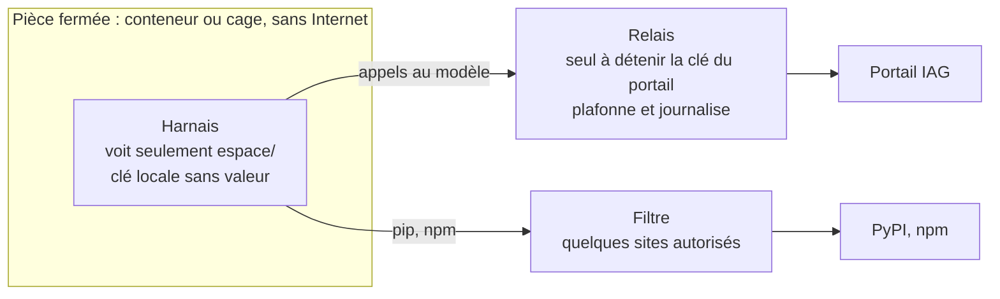

# Kit de sécurisation d'un harnais d'agent

Ce dossier rassemble des consignes et des scripts à copier dans un projet. Ils permettent de faire travailler un harnais d'agent (Goose, OpenCode, gptme, Pi, Cline ou un autre) sans risque pour le poste ni pour la clé du portail IAG. Le portail IAG est le « cerveau » du harnais : une API compatible OpenAI, qui s'utilise avec une adresse et une clé.

## Le principe

Un harnais exécute les commandes que décide un modèle de langage. Le modèle peut se tromper, ou obéir à une consigne cachée dans un document. Le kit ne fait donc pas confiance au harnais : il borne ce que le harnais peut atteindre.

- **Pièce fermée.** Le harnais ne voit que le dossier `espace/`. Le reste du poste lui est invisible.
- **Relais.** Il détient la clé du portail : le harnais ne la voit jamais. Il plafonne les jetons et le débit, et note chaque appel, sans le contenu.
- **Filtre.** C'est la seule sortie vers Internet, limitée aux sites de paquets.
- **Vérificateur.** Il contrôle 21 protections avant de commencer.

Le détail de chaque protection et de ses raisons se trouve dans [guide/01-principe-et-risques.md](guide/01-principe-et-risques.md).

## Par où commencer

**1. Choisir le mode.** Lancer ces commandes sur le poste (Linux, ou WSL2 sous Windows) et prendre la première qui affiche une version :

| Commande | Mode | Guide d'installation |
|---|---|---|
| `docker compose version` | Docker | [guide/02-installation-docker.md](guide/02-installation-docker.md) |
| `podman --version` | Podman | [guide/03-installation-podman.md](guide/03-installation-podman.md) |
| `bwrap --version` | Sans conteneur (bubblewrap) | [guide/04-installation-sans-conteneur.md](guide/04-installation-sans-conteneur.md) |

Si aucune commande ne répond, installer Podman ou bubblewrap : une commande sur Ubuntu, donnée au début des guides 03 et 04. Les protections sont les mêmes dans les trois modes.

**2. Suivre le guide d'installation du mode choisi.** Compter environ 30 minutes : réglages, vérification, premier lancement.

**3. Brancher le harnais** avec [guide/05-brancher-un-harnais.md](guide/05-brancher-un-harnais.md).

## Les documents

| Document | À lire pour |
|---|---|
| [01-principe-et-risques.md](guide/01-principe-et-risques.md) | comprendre les risques, chaque protection et ses limites |
| [02-installation-docker.md](guide/02-installation-docker.md) | installer et utiliser le kit avec Docker |
| [03-installation-podman.md](guide/03-installation-podman.md) | installer et utiliser le kit avec Podman |
| [04-installation-sans-conteneur.md](guide/04-installation-sans-conteneur.md) | installer et utiliser le kit sans conteneur |
| [05-brancher-un-harnais.md](guide/05-brancher-un-harnais.md) | installer et configurer Goose, OpenCode, gptme, Pi, Cline ou un autre harnais |
| [06-reglages.md](guide/06-reglages.md) | régler `.env` (portail, plafonds, proxy d'entreprise) et préparer les questions au portail |
| [07-depannage.md](guide/07-depannage.md) | corriger un problème ou une ligne `NON CONFORME` |
| [08-test-a-plusieurs.md](guide/08-test-a-plusieurs.md) | organiser un test avec plusieurs testeurs |

## Contenu du dossier

| Élément | Rôle |
|---|---|
| `.env.exemple`, `preparer.sh` | modèle des réglages ; script qui crée `.env` et la clé locale du relais |
| `relais/portail.py` | relais vers le portail IAG |
| `relais/filtre.py` | filtre des téléchargements |
| `verifier/verifier.py` | contrôle des 21 protections |
| `outils/bilan.py` | bilan de consommation : appels, jetons, refus |
| `outils/faux_portail.py` | faux portail, pour tout essayer sans clé |
| `compose.yaml`, `harnais/Dockerfile` | modes Docker et Podman : conteneurs et image du harnais |
| `compose.podman.yaml` | complément pour le mode Podman |
| `sans-conteneur/` | mode sans conteneur : lanceur et cage |

## Trois règles

- Ne déposer dans `espace/` que des données que le portail IAG a le droit de recevoir : tout ce que le harnais lit peut partir au modèle.
- Une clé personnelle du portail par testeur ; `.env` n'est jamais partagé ni versionné.
- Ne pas commencer de test tant que le vérificateur n'affiche pas `21 sur 21`.
