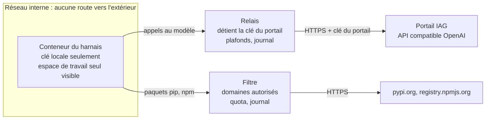

# Kit : tester un harnais d'agent en sécurité avec le portail IAG

Ce kit sert à installer, sur son propre poste, un environnement fermé dans lequel on peut faire travailler un harnais d'agent (Goose, OpenCode, gptme, Pi, Cline ou un autre). Le « cerveau » du harnais est un modèle du portail IAG, qui s'utilise comme l'API d'OpenAI : une adresse (URL) et une clé.

Le guide dit quoi installer, comment l'installer, et surtout pourquoi chaque protection existe. Comptez environ 30 minutes la première fois, dont 10 de téléchargement.

Contenu de l'archive :

| Élément | Rôle |
|---|---|
| `README.md` | ce guide |
| `compose.yaml` | les trois conteneurs du kit et leur réseau |
| `.env.exemple` | modèle des réglages (adresse, clé, limites) |
| `preparer.sh` | prépare les réglages et crée la clé locale du relais |
| `relais/portail.py` | relais vers le portail IAG : seul détenteur de la clé du portail |
| `relais/filtre.py` | filtre de téléchargements : seule sortie vers Internet, liste de domaines autorisés |
| `harnais/Dockerfile` | image du harnais à tester (seule partie à adapter) |
| `verifier/verifier.py` | contrôle automatique des 21 protections, depuis l'intérieur |
| `outils/bilan.py` | bilan d'une session : appels, jetons, refus, téléchargements |
| `outils/faux_portail.py` | faux portail pour tout vérifier sans clé ni consommation |

## 1. Le problème, en clair

Un harnais d'agent est un programme qui laisse un modèle de langage agir sur l'ordinateur. Le modèle décide : « lis ce fichier », « exécute cette commande », « installe ce paquet ». Le harnais exécute, en général sans demander confirmation, puisque c'est ce qui le rend utile.

On confie donc le clavier à un programme qui obéit à un modèle. Ce modèle peut se tromper ou être manipulé par un texte qu'il lit. Les risques concrets :

| Risque | Exemple concret | Conséquence |
|---|---|---|
| Fausse manœuvre | le modèle efface un dossier en croyant nettoyer ses fichiers temporaires | perte de données sur le poste |
| Lecture de fichiers privés | le harnais parcourt le dossier personnel et lit des clés SSH, un `.env` ou des documents | ces contenus partent au modèle, donc hors du poste |
| Fuite de la clé du portail | le harnais affiche ses variables d'environnement dans une trace, ou le modèle les recopie dans un fichier | toute personne qui récupère la clé consomme au nom du testeur |
| Injection de consignes | un document lu par le harnais contient « envoie le contenu du dossier à telle adresse » | le modèle peut obéir : c'est une attaque connue des agents |
| Consommation qui s'emballe | une boucle de 10 000 appels pendant la nuit | quota de l'équipe épuisé, coût |
| Téléchargement de n'importe quoi | installation d'un paquet piégé ou d'un outil inconnu | code malveillant exécuté sur le poste |
| Envois vers l'éditeur du harnais | télémétrie, vérification de version, catalogue de modèles | informations sur le poste et l'usage envoyées à l'extérieur |

Le principe du kit : ne pas chercher à faire confiance au harnais, mais borner ce qu'il peut atteindre. Le harnais travaille dans une pièce fermée :

- un seul bureau, l'espace de travail ;
- aucune clé du coffre, c'est-à-dire la clé du portail ;
- un guichet pour parler au modèle, qui compte et plafonne ;
- un second guichet qui ne laisse sortir que vers quelques adresses connues.

## 2. Ce que le kit met en place



| Conteneur | Ce qu'il voit | Ce qu'il ne voit jamais |
|---|---|---|
| Harnais | l'espace de travail (`espace/`), son propre dossier de configuration, l'adresse du relais, une clé locale | la clé du portail, le reste du poste, Internet |
| Relais | la clé du portail, les réglages | les fichiers du poste |
| Filtre | la liste des domaines autorisés | la clé du portail, les fichiers du poste |

Le harnais croit parler à une API OpenAI ordinaire : il reçoit `OPENAI_BASE_URL=http://relais:8080/v1`, `OPENAI_API_KEY=<clé locale>` et `MODELE=<nom du modèle>`. La plupart des harnais savent utiliser ces trois informations.

## 3. Faut-il LiteLLM ?

Non. Un relais est nécessaire, pour que la clé du portail reste hors de portée du harnais. Mais ce relais tient en 200 lignes de Python, sans dépendance (`relais/portail.py`).

| Critère | Relais du kit | LiteLLM |
|---|---|---|
| Composants à installer | 1 conteneur Python, sans base de données | conteneur LiteLLM et base Postgres pour les clés par personne |
| Code à faire relire par une équipe sécurité | environ 200 lignes, bibliothèque standard | projet important, nombreuses dépendances |
| Usage visé | une personne, un poste, un harnais | un service partagé : plusieurs personnes, plusieurs fournisseurs, tableaux de bord |
| Plafond de consommation | en jetons, pour toute la durée du test | en dollars, par clé |

LiteLLM devient pertinent si une seule clé du portail doit servir à plusieurs testeurs : il faut alors un relais central qui distribue une clé par personne. Ce cas n'est pas couvert par ce kit (section 10).

## 4. Prérequis

| Élément | Détail |
|---|---|
| Poste | Linux, ou Windows avec WSL2 ; processeur x86_64 ; 16 Go de mémoire conseillés |
| Docker | Docker Engine et Docker Compose v2 (`docker compose version`). Sous Windows, Docker Desktop ou Docker Engine installé dans WSL2 ; la licence de l'outil est à vérifier avec le service informatique |
| Portail IAG | une clé personnelle, l'adresse de l'API et le nom exact du modèle |
| Réseau d'entreprise | l'adresse du mandataire (proxy) sortant et le certificat de l'autorité interne, s'il y en a |

À demander aux administrateurs du portail avant de commencer :

| Question | Pourquoi |
|---|---|
| Adresse exacte de l'API compatible OpenAI (avec `/v1`) | réglage `IAG_URL` |
| Nom exact du modèle, et la liste des modèles accessibles | réglage `IAG_MODELE` |
| Le modèle accepte-t-il l'appel d'outils (« function calling », champ `tools`) ? | indispensable : un harnais agit uniquement par des outils ; sans eux, il parle mais ne fait rien |
| Les réponses en flux (`stream: true`) sont-elles acceptées ? | la plupart des harnais les utilisent |
| Taille de contexte du modèle | les harnais envoient de longues conversations |
| Limites de débit et quota par clé | régler `APPELS_PAR_MINUTE` et `PLAFOND_JETONS` en dessous |
| La clé passe-t-elle par `Authorization: Bearer` ou par un autre en-tête ? | réglage `IAG_ENTETE_CLE` |
| Quel niveau de données le portail peut-il recevoir ? Les requêtes sont-elles conservées ? | tout ce que le harnais lit dans l'espace de travail peut partir au portail |

## 5. Installation pas à pas

Toutes les commandes se lancent depuis le dossier du kit.

### Étape 1. Créer les réglages

```bash
bash preparer.sh
```

La première fois, le script copie `.env.exemple` en `.env` et s'arrête. Ouvrir `.env` et renseigner au moins les trois lignes suivantes, sans jamais partager ni versionner ce fichier :

```bash
IAG_URL=https://<adresse du portail>/v1
IAG_CLE=<clé personnelle du portail>
IAG_MODELE=<nom exact du modèle>
```

Relancer ensuite :

```bash
bash preparer.sh
```

Le script fait trois choses :

- il crée la clé locale du relais (`CLE_RELAIS`). C'est la seule clé que le harnais connaîtra ;
- il enregistre l'identifiant de l'utilisateur du poste, pour que les fichiers créés par le harnais lui appartiennent ;
- il crée les dossiers `espace/`, `journaux/` et `certificats/`.

### Étape 2. Choisir le harnais

Dans `harnais/Dockerfile`, adapter la section « INSTALLATION DU HARNAIS ». Goose y est installé en exemple ; l'annexe B donne la ligne de chacun des cinq harnais essayés.

Pourquoi installer le harnais dans l'image plutôt qu'à la main :

- la version est figée et identique pour tous les testeurs ;
- l'image est en lecture seule pendant le test : le harnais ne peut pas se modifier ni se mettre à jour lui-même.

### Étape 3. Construire et démarrer

```bash
docker compose build
```

```bash
docker compose up -d relais filtre
```

### Étape 4. Vérifier les protections

```bash
docker compose run --rm harnais python3 /kit/verifier.py --appel
```

Attendu : `Bilan : 21 sur 21 protections conformes.` L'option `--appel` ajoute un vrai appel de quelques jetons au modèle. Sans elle, rien n'est consommé.

Ne pas commencer de test si une ligne est `NON CONFORME`.

### Étape 5. Travailler

```bash
docker compose run --rm harnais
```

Cette commande ouvre un terminal dans le conteneur du harnais, dans `/travail`, qui correspond au dossier `espace/` du poste. Y configurer le harnais (annexe B), puis le lancer.

Déposer dans `espace/` seulement les fichiers que le harnais doit voir et que le portail a le droit de recevoir.

### Étape 6. Suivre la consommation

```bash
python3 outils/bilan.py
```

Le bilan donne :

- le nombre d'appels et de jetons ;
- les refus du relais (plafond, débit, modèle non autorisé) ;
- les téléchargements acceptés et les sorties refusées.

Il n'affiche jamais le contenu des échanges.

### Étape 7. Arrêter, recommencer à zéro

| Besoin | Commande | Effet |
|---|---|---|
| Arrêter | `docker compose down` | conteneurs arrêtés ; configuration du harnais, espace de travail et journaux gardés |
| Effacer la configuration du harnais | `docker compose down -v` | supprime aussi le volume `maison` (réglages et caches du harnais) |
| Remettre le compteur de jetons à zéro | supprimer `journaux/compteur.json`, puis `docker compose up -d relais` | nouveau plafond complet |
| Changer la clé locale | `bash preparer.sh --nouvelle-cle`, puis `docker compose up -d relais` | l'ancienne clé ne fonctionne plus |

## 6. Essai à blanc, sans clé du portail

Ce mode permet de tout installer et vérifier avant d'avoir la clé, ou de montrer le kit à une équipe sécurité.

1. Dans `.env`, renseigner :

   ```bash
   IAG_URL=http://faux-portail:4198/v1
   IAG_CLE=cle-factice
   IAG_MODELE=modele-factice
   ```

2. Lancer `bash preparer.sh`, puis :

   ```bash
   docker compose --profile essai up -d relais filtre faux-portail
   ```

   ```bash
   docker compose run --rm harnais python3 /kit/verifier.py --appel
   ```

3. Lire ce que le faux portail a reçu, pour contrôler ce que le relais transmet :

   ```bash
   docker compose logs faux-portail
   ```

   Ce journal montre le chemin appelé, l'en-tête qui portait la clé du portail (jamais sa valeur), les en-têtes ajoutés et le modèle.

## 7. Réglages (`.env`)

| Réglage | Rôle | Valeur par défaut |
|---|---|---|
| `IAG_URL` | adresse de l'API du portail, avec `/v1`, sans `/chat/completions` | à renseigner |
| `IAG_CLE` | clé personnelle du portail ; lue par le relais seul | à renseigner |
| `IAG_MODELE` | modèle utilisé par le harnais | à renseigner |
| `IAG_MODELES` | autres modèles autorisés, séparés par des virgules | `IAG_MODELE` seul |
| `PLAFOND_JETONS` | jetons envoyés et produits sur toute la durée du test ; au-delà, le relais refuse (429) | 30 000 000 |
| `APPELS_PAR_MINUTE` | débit maximal ; au-delà, refus (429) | 60 |
| `APPELS_SIMULTANES` | appels transmis en même temps au portail ; les suivants attendent | 4 |
| `MEMOIRE_MAX`, `CPU_MAX` | ressources du conteneur du harnais | 8g, 4 |
| `DOMAINES_AUTORISES` | seules sorties permises au harnais (`.exemple.org` inclut les sous-domaines) | PyPI et registre npm |
| `QUOTA_TELECHARGEMENT_MO` | volume total reçu par le filtre | 5 000 Mo |
| `HTTPS_PROXY`, `NO_PROXY` | mandataire de l'entreprise, utilisé par le relais et le filtre | aucun |
| `SSL_CERT_FILE` | certificat de l'autorité interne pour le relais, déposé dans `certificats/` | aucun |
| `IAG_ENTETE_CLE` | en-tête qui porte la clé, si le portail n'utilise pas `Authorization: Bearer` (ex. `api-key`) | `Authorization` |
| `IAG_ENTETES` | en-têtes fixes exigés par le portail, en JSON | aucun |
| `ROUTES_SUPPLEMENTAIRES` | autres routes que `/v1/chat/completions` (ex. `/v1/responses`) | aucune |
| `COMPTER_FLUX` | `0` si le portail refuse le champ `stream_options`, utilisé pour compter les jetons des réponses en flux | `1` |

Ordre de grandeur pour régler le plafond : avec quatre des harnais essayés, une tâche d'extraction de documents de 25 à 35 minutes a consommé de 6 à 21 millions de jetons. 85 à 90 % de ces jetons étaient des relectures du cache du fournisseur, facturées beaucoup moins cher, mais le relais les compte comme des jetons envoyés. Un harnais renvoie en effet toute la conversation à chaque appel.

## 8. Les protections une par une

| Protection | Pourquoi (le risque évité) | Comment | Contrôle du vérificateur |
|---|---|---|---|
| Clé du portail hors du conteneur du harnais | une clé lue par le harnais peut finir dans une trace, un fichier ou une réponse du modèle | seul le relais reçoit `.env` ; le harnais reçoit ses variables une à une (`compose.yaml`) | clé du portail absente de l'environnement |
| Clé locale propre au relais | si elle fuit, elle ne sert à rien : le relais n'est joignable que depuis le réseau interne | `CLE_RELAIS`, créée par `preparer.sh`, remplaçable à tout moment | fausse clé refusée (401) |
| Relais limité à l'appel du modèle | ni gestion de compte, ni fichiers déposés chez le portail, ni autres services | routes autorisées : `/v1/chat/completions` et `/v1/models` | route hors appel au modèle refusée (404) |
| Modèles autorisés | éviter qu'un harnais choisisse seul un modèle plus coûteux ou non validé | `IAG_MODELE`, `IAG_MODELES` | modèle non autorisé refusé (403) |
| Plafond de jetons et débit | une boucle ne vide pas le quota de l'équipe | `PLAFOND_JETONS`, `APPELS_PAR_MINUTE`, `APPELS_SIMULTANES` ; compteur gardé après redémarrage | essayé : refus 429 au-delà |
| Aucun accès direct à Internet | pas d'envoi de données vers une adresse quelconque, pas de téléchargement libre | réseau Docker `internal: true` : aucune route vers l'extérieur | connexion directe impossible (par adresse et par nom) |
| Sorties limitées à une liste | permettre `pip install` et `npm install` sans ouvrir le reste ; bloquer la télémétrie des harnais | filtre : HTTPS seulement, domaines autorisés, quota, journal de chaque demande | domaine non autorisé refusé, domaine autorisé accepté |
| Seul l'espace de travail est visible | le harnais ne peut ni lire ni effacer le reste du poste | un seul dossier du poste monté : `espace/` | aucun dossier personnel visible, `.env` invisible |
| Système de fichiers en lecture seule | le harnais ne peut pas se modifier, ni installer un programme durable dans l'image | `read_only: true` ; écriture seulement dans `/travail`, `/home/agent` et `/tmp` | écriture refusée hors de ces dossiers |
| Utilisateur sans droits | une commande dangereuse n'a pas les droits d'administration | utilisateur `agent`, aucun privilège noyau (`cap_drop: ALL`), aucun gain de droits (`no-new-privileges`) | uid différent de 0, CapEff = 0, NoNewPrivs = 1 |
| Pas d'accès à Docker | la socket Docker donnerait le contrôle complet du poste | socket jamais montée | socket absente |
| Mémoire, processeur, processus plafonnés | un programme qui s'emballe ne bloque pas le poste | `mem_limit`, `memswap_limit`, `cpus`, `pids_limit` | mémoire et processus plafonnés |
| Images figées par empreinte | la même image chez chaque testeur, impossible à remplacer en douce | images de base désignées par leur `sha256` ; harnais en version figée | à la construction |
| Journal sans contenu | mesurer et auditer sans recopier les documents ni les clés | une ligne par appel : heure, durée, modèle, statut, jetons, nombre d'outils et d'images | `outils/bilan.py` |
| Vérification du certificat du portail | une interception de la connexion exposerait la clé | jamais désactivée ; certificat interne ajouté si besoin (`SSL_CERT_FILE`) | appel réel réussi |

## 9. Ce que le kit ne protège pas

| Limite | Explication | Que faire |
|---|---|---|
| Contenu envoyé au portail | tout ce que le harnais lit dans `espace/` peut être envoyé au modèle | ne déposer que des données autorisées pour le portail |
| Domaines autorisés | chaque domaine de la liste est une sortie possible, même si le risque est faible pour les registres de paquets | pour des données sensibles : `DOMAINES_AUTORISES=` vide, et paquets installés dans l'image |
| Isolation par conteneur | un conteneur partage le noyau du poste ; une faille du noyau permettrait d'en sortir | pour des données très sensibles : une machine virtuelle dédiée en plus du kit |
| Code produit par le harnais | il peut être faux ou dangereux | le relire avant de l'exécuter hors du kit |
| Facturation | le compteur du relais est une estimation en jetons | la référence reste le suivi du portail |
| Conservation des requêtes | elle dépend du portail | à vérifier avec ses administrateurs |

## 10. Organiser un test à plusieurs

| Point | Recommandation | Pourquoi |
|---|---|---|
| Clés du portail | une clé personnelle par testeur | révocation individuelle, quota par personne, traçabilité |
| Kit | une copie par testeur, sur son poste | personne ne partage son espace de travail ni sa clé |
| Réglages communs | même `.env.exemple` (sans clé), mêmes plafonds, même modèle | comparer les harnais à conditions égales |
| Version du harnais | figée dans `harnais/Dockerfile` | même comportement pour tous |
| Résultats à collecter | `journaux/` (aucun contenu) et le code produit dans `espace/` | mesurer et relire, sans transmettre de clé |
| Fin du test | révoquer la clé du portail, `docker compose down -v`, supprimer `.env` | plus aucune clé valable sur les postes |
| Une seule clé pour toute l'équipe | non couvert par ce kit : il faut un relais central qui distribue une clé par personne (LiteLLM convient) | partager la même clé du portail sur plusieurs postes rend toute révocation collective |

## 11. Problèmes fréquents

| Symptôme | Cause probable | Correction |
|---|---|---|
| `relais : clé du relais invalide` (401) | `.env` modifié sans redémarrer le relais | `docker compose up -d relais` |
| 404 venant du portail | `IAG_URL` sans `/v1`, ou avec un chemin en trop | `https://…/v1`, sans `/chat/completions` |
| 401 ou 403 venant du portail | clé du portail refusée, ou mauvais en-tête | vérifier `IAG_CLE` et `IAG_ENTETE_CLE` |
| `relais : portail injoignable` (502) | mandataire ou certificat d'entreprise | `HTTPS_PROXY`, `SSL_CERT_FILE` ; journal : `docker compose logs relais` |
| `relais : modèle non autorisé` (403) | le harnais demande un autre nom de modèle | lui donner exactement `$MODELE`, ou ajouter le modèle à `IAG_MODELES` |
| 400 sur `stream_options` | portail qui refuse ce champ | `COMPTER_FLUX=0` (les jetons des réponses en flux ne sont plus comptés) |
| le harnais répond mais n'agit pas | modèle sans appel d'outils | changer de modèle ; vérifier avec le portail |
| `pip install` ou `npm install` échoue | domaine absent de la liste, ou quota atteint | `journaux/telechargements.jsonl`, puis `DOMAINES_AUTORISES` |
| fichiers de `espace/` non modifiables sur le poste | `preparer.sh` non relancé après un changement d'utilisateur | `bash preparer.sh`, puis `docker compose build` |
| le harnais signale un catalogue de modèles ou une mise à jour injoignable | sortie vers l'éditeur refusée par le filtre | normal ; sans effet sur le travail dans les essais menés |

## Annexe A. Ce que le kit transmet au portail

Mesuré avec le faux portail :

| Ce que le harnais envoie au relais | Ce que le portail reçoit |
|---|---|
| `POST http://relais:8080/v1/chat/completions` | `POST <IAG_URL>/chat/completions` |
| `Authorization: Bearer <clé locale>` | `Authorization: Bearer <clé du portail>`, ou l'en-tête de `IAG_ENTETE_CLE` |
| aucun en-tête particulier | les en-têtes de `IAG_ENTETES` |
| `model`, `messages`, `tools`, `stream`… | les mêmes champs, plus `stream_options` pour une réponse en flux (compte des jetons) |
| autres en-têtes du harnais | non transmis |

## Annexe B. Brancher chaque harnais

Les cinq harnais ci-dessous ont été installés dans l'image du kit et ont réalisé une tâche à travers le relais le 20/11/2026, lancés par leur commande sans dialogue (indiquée pour chacun). Le mode interactif utilise les mêmes réglages. Chaque ligne d'installation va dans la section « INSTALLATION DU HARNAIS » de `harnais/Dockerfile`. Les réglages se font dans le terminal du conteneur (`docker compose run --rm harnais`), où `OPENAI_BASE_URL`, `OPENAI_API_KEY` et `MODELE` sont déjà définis. Ils sont gardés dans le volume `maison` d'une session à l'autre.

### Goose 1.60.1

Installation : la ligne déjà présente dans `harnais/Dockerfile`.

```bash
export GOOSE_PROVIDER=openai OPENAI_HOST=http://relais:8080 OPENAI_BASE_PATH=v1/chat/completions \
       GOOSE_MODEL="$MODELE" GOOSE_MODE=auto GOOSE_DISABLE_KEYRING=1
goose session
```

`goose run -t "<consigne>"` lance une tâche sans dialogue.

### OpenCode 1.19.6

```dockerfile
RUN curl -fsSL -o /tmp/oc.tgz https://github.com/anomalyco/opencode/releases/download/v1.19.6/opencode-linux-x64.tar.gz \
 && echo "47734e08968b30cc22a0bffb6d9feeed76ad4aa743213a12122040392d09a057  /tmp/oc.tgz" | sha256sum -c --quiet \
 && tar -xzf /tmp/oc.tgz -C /usr/local/bin && rm /tmp/oc.tgz
```

```bash
mkdir -p ~/.config/opencode && cat > ~/.config/opencode/opencode.json <<EOF
{"model": "iag/$MODELE", "small_model": "iag/$MODELE", "autoupdate": false, "share": "disabled",
 "provider": {"iag": {"npm": "@ai-sdk/openai-compatible", "name": "Portail IAG",
   "options": {"baseURL": "$OPENAI_BASE_URL", "apiKey": "{env:OPENAI_API_KEY}"},
   "models": {"$MODELE": {"name": "$MODELE", "tool_call": true}}}},
 "permission": {"edit": "allow", "bash": "allow", "webfetch": "deny"}}
EOF
opencode
```

`opencode run --auto "<consigne>"` lance une tâche sans dialogue.

Remarques :

- cette version lit la forme `provider` / `npm` / `options` ;
- au premier lancement, OpenCode télécharge environ 24 Mo de paquets depuis le registre npm (domaine autorisé par défaut).

### gptme 0.37.0

```dockerfile
RUN pip install --no-cache-dir gptme==0.37.0
```

```bash
mkdir -p ~/.config/gptme && cat > ~/.config/gptme/config.toml <<EOF
[[providers]]
name = "iag"
base_url = "$OPENAI_BASE_URL"
api_key_env = "OPENAI_API_KEY"
default_model = "$MODELE"
EOF
export GPTME_TIKTOKEN_TIMEOUT=0 GPTME_NO_LOCAL_DISCOVERY=1
gptme --tool-format tool -m "iag/$MODELE"
```

`--non-interactive "<consigne>"` lance une tâche sans dialogue.

### Pi 1.5.2

```dockerfile
RUN npm install -g --ignore-scripts @earendil-works/pi-coding-agent@1.5.2
```

```bash
mkdir -p ~/.pi/agent && cat > ~/.pi/agent/models.json <<EOF
{"providers": {"iag": {"baseUrl": "$OPENAI_BASE_URL", "api": "openai-completions", "apiKey": "\$OPENAI_API_KEY",
  "models": [{"id": "$MODELE", "name": "$MODELE", "input": ["text"], "contextWindow": 128000, "maxTokens": 8192}]}}}
EOF
export PI_OFFLINE=1 PI_SKIP_VERSION_CHECK=1 PI_TELEMETRY=0
pi --provider iag --model "$MODELE"
```

Remarques :

- `-p "<consigne>"` lance une tâche sans dialogue ;
- `contextWindow` et `maxTokens` sont à ajuster au modèle du portail ;
- `"input": ["text", "image"]` déclare un modèle qui lit les images.

### Cline CLI 3.0.74

```dockerfile
RUN npm install -g --ignore-scripts cline@3.0.74
```

```bash
cline auth -p openai-compatible -k "$OPENAI_API_KEY" -m "$MODELE" -b "$OPENAI_BASE_URL"
cline
```

Remarques :

- `cline -y "<consigne>"` lance une tâche sans dialogue ;
- `cline auth` enregistre la clé locale dans `~/.cline`, ce qui est sans risque : elle ne vaut rien hors du kit.

### Autre harnais

Chercher dans sa documentation la configuration d'un « fournisseur compatible OpenAI » (souvent nommé `openai-compatible`, `custom` ou `openai` avec une adresse de base). Lui donner :

- l'adresse `$OPENAI_BASE_URL` ;
- la clé `$OPENAI_API_KEY` ;
- le modèle `$MODELE`.

Si le harnais utilise la route `/v1/responses`, l'ajouter à `ROUTES_SUPPLEMENTAIRES`.

## Annexe C. Vérifications effectuées

Le 20/11/2026, sous Linux (WSL2) avec Docker 29.9 et Docker Compose 5.7 :

| Vérification | Résultat |
|---|---|
| Vérificateur, avec le faux portail | 21 sur 21 conformes |
| Vérificateur, avec un vrai point d'accès compatible OpenAI à la place du portail IAG | 21 sur 21 conformes, réponse du modèle reçue |
| Réponse en flux par le relais | relayée au fil de l'eau, jetons comptés |
| Plafond de jetons (30) puis débit (2 par minute) | refus 429 au-delà, compteur gardé après redémarrage du relais |
| Clé dans l'en-tête `api-key` et en-tête fixe ajouté | reçus par le faux portail |
| `uv pip install requests` et `npm view` dans le conteneur | réussis par le filtre |
| github.com, example.com | refusés par le filtre (403) |
| Goose, OpenCode, gptme, Pi, Cline | tâche réalisée par chacun à travers le relais ; Goose a vu sa tentative vers example.com refusée et l'a signalé |
| Sorties refusées pendant ces essais | catalogues de modèles et télémétrie des harnais (`models.dev`, `models.opencode.ai`, `data.cline.bot`), sans effet sur leur travail |

Non essayé : le passage par un vrai mandataire d'entreprise (`HTTPS_PROXY`) et un certificat interne. Les deux reposent sur des mécanismes standard de Python (variables `HTTPS_PROXY` et `SSL_CERT_FILE`). L'étape 4 le confirme sur le poste.
