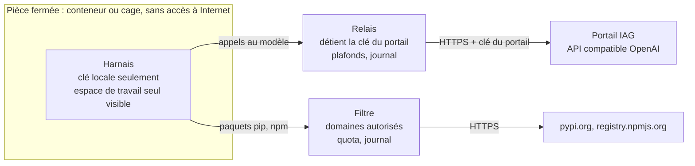

# Kit : tester un harnais d'agent en sécurité avec le portail IAG

Ce kit sert à installer, sur son propre poste, un environnement fermé dans lequel on peut faire travailler un harnais d'agent (Goose, OpenCode, gptme, Pi, Cline ou un autre). Le « cerveau » du harnais est un modèle du portail IAG, qui s'utilise comme l'API d'OpenAI : une adresse (URL) et une clé.

Le kit fonctionne de trois façons, selon ce que le poste permet :

- avec Docker ;
- avec Podman ;
- sans conteneur, avec bubblewrap.

Les protections sont les mêmes dans les trois cas. Le guide dit quoi installer, comment l'installer, et surtout pourquoi chaque protection existe. Comptez environ 30 minutes la première fois.

Contenu de l'archive :

| Élément | Rôle | Mode |
|---|---|---|
| `README.md` | ce guide | tous |
| `.env.exemple` | modèle des réglages (adresse, clé, limites) | tous |
| `preparer.sh` | prépare les réglages et crée la clé locale du relais | tous |
| `relais/portail.py` | relais vers le portail IAG : seul détenteur de la clé du portail | tous |
| `relais/filtre.py` | filtre de téléchargements : seule sortie vers Internet, liste de domaines autorisés | tous |
| `verifier/verifier.py` | contrôle automatique des 21 protections, depuis l'endroit où tourne le harnais | tous |
| `outils/bilan.py` | bilan d'une session : appels, jetons, refus, téléchargements | tous |
| `outils/faux_portail.py` | faux portail pour tout vérifier sans clé ni consommation | tous |
| `compose.yaml` | les trois conteneurs du kit et leur réseau | Docker, Podman |
| `harnais/Dockerfile` | image du harnais à tester (seule partie à adapter) | Docker, Podman |
| `compose.podman.yaml` | complément pour Podman sans droits root | Podman |
| `sans-conteneur/lancer.py` | lance le relais, le filtre et la cage du harnais | sans conteneur |
| `sans-conteneur/passerelle.py` | dans la cage, seul pont vers le relais et le filtre | sans conteneur |

## 1. Le problème, en clair

Un harnais d'agent est un programme qui laisse un modèle de langage agir sur l'ordinateur. Le modèle décide : « lis ce fichier », « exécute cette commande », « installe ce paquet ». Le harnais exécute, en général sans demander confirmation, puisque c'est ce qui le rend utile.

On confie donc le clavier à un programme qui obéit à un modèle. Ce modèle peut se tromper ou être manipulé par un texte qu'il lit. Les risques concrets :

| Risque | Exemple concret | Conséquence |
|---|---|---|
| Fausse manœuvre | le modèle efface un dossier en croyant nettoyer ses fichiers temporaires | perte de données sur le poste |
| Lecture de fichiers privés | le harnais parcourt le dossier personnel et lit des clés SSH, un `.env` ou des documents | ces contenus partent au modèle, donc hors du poste |
| Fuite de la clé du portail | le harnais affiche ses variables d'environnement dans une trace, ou le modèle les recopie dans un fichier | toute personne qui récupère la clé consomme au nom du testeur |
| Injection de consignes | un document lu par le harnais contient « envoie le contenu du dossier à telle adresse » | le modèle peut obéir : c'est une attaque connue des agents |
| Consommation qui s'emballe | une boucle de 10 000 appels pendant la nuit | quota de l'équipe épuisé, coût |
| Téléchargement de n'importe quoi | installation d'un paquet piégé ou d'un outil inconnu | code malveillant exécuté sur le poste |
| Envois vers l'éditeur du harnais | télémétrie, vérification de version, catalogue de modèles | informations sur le poste et l'usage envoyées à l'extérieur |

Le principe du kit : ne pas chercher à faire confiance au harnais, mais borner ce qu'il peut atteindre. Le harnais travaille dans une pièce fermée :

- un seul bureau, l'espace de travail ;
- aucune clé du coffre, c'est-à-dire la clé du portail ;
- un guichet pour parler au modèle, qui compte et plafonne ;
- un second guichet qui ne laisse sortir que vers quelques adresses connues.

## 2. Ce que le kit met en place



| Pièce | Ce qu'elle voit | Ce qu'elle ne voit jamais |
|---|---|---|
| Harnais | l'espace de travail (`espace/`), son propre dossier de configuration, l'adresse du relais, une clé locale | la clé du portail, le reste du poste, Internet |
| Relais | la clé du portail, les réglages | les fichiers du poste (avec conteneur) |
| Filtre | la liste des domaines autorisés | la clé du portail, les fichiers du poste (avec conteneur) |

Le harnais croit parler à une API OpenAI ordinaire. Il reçoit trois variables, que la plupart des harnais savent utiliser :

- `OPENAI_BASE_URL`, l'adresse du relais : `http://relais:8080/v1` avec conteneur, `http://127.0.0.1:8080/v1` sans conteneur ;
- `OPENAI_API_KEY`, la clé locale ;
- `MODELE`, le nom du modèle.

## 3. Prérequis et choix du mode

### Par où commencer

Lancer ces trois commandes sur le poste et prendre le premier mode qui répond :

| Ordre | Commande | Si elle affiche une version |
|---|---|---|
| 1 | `docker compose version` | mode Docker (section 4.2) |
| 2 | `podman --version` | mode Podman (section 4.3) |
| 3 | `bwrap --version` | mode sans conteneur (section 4.4) |

Si aucune ne répond, installer Podman ou bubblewrap (sections 4.3 et 4.4 : une commande sur Ubuntu 24.04, avec les droits d'administration).

### Prérequis

Communs aux trois modes :

| Élément | Détail |
|---|---|
| Poste | Linux, ou Windows avec WSL2 ; processeur x86_64 ; 16 Go de mémoire conseillés |
| Portail IAG | une clé personnelle, l'adresse de l'API et le nom exact du modèle |
| Réseau d'entreprise | l'adresse du mandataire (proxy) sortant et le certificat de l'autorité interne, s'il y en a |

Choix du mode :

| Critère | Docker | Podman | Sans conteneur |
|---|---|---|---|
| À choisir si | Docker est installé | Podman est installé, pas Docker | aucun des deux n'est disponible |
| Logiciels nécessaires | Docker Engine, Docker Compose v2 | Podman 4 ou plus, `podman compose` (avec docker-compose ou podman-compose) | bubblewrap, python3, systemd (session de l'utilisateur) |
| Ce qui enferme le harnais | conteneur et réseau Docker interne | conteneur et réseau Podman interne | cage bubblewrap : espaces de noms du noyau, comme un conteneur, sans image |
| Installation du harnais | dans l'image (`harnais/Dockerfile`), version identique pour tous | dans l'image (`harnais/Dockerfile`), version identique pour tous | dans `sans-conteneur/harnais/`, à la main sur chaque poste |
| Système vu par le harnais | celui de l'image, en lecture seule | celui de l'image, en lecture seule | `/usr` et `/etc` du poste, en lecture seule |
| Limites de mémoire et de processus | appliquées par Docker | appliquées si le système délègue ces réglages à l'utilisateur (c'est le cas par défaut sur Ubuntu 24.04) | appliquées par systemd (`systemd-run --user`) |
| Installation | section 4.2 | section 4.3 | section 4.4 |

### Questions au portail

À demander aux administrateurs du portail avant de commencer :

| Question | Pourquoi |
|---|---|
| Adresse exacte de l'API compatible OpenAI (avec `/v1`) | réglage `IAG_URL` |
| Nom exact du modèle, et la liste des modèles accessibles | réglage `IAG_MODELE` |
| Le modèle accepte-t-il l'appel d'outils (« function calling », champ `tools`) ? | indispensable : un harnais agit uniquement par des outils ; sans eux, il parle mais ne fait rien |
| Les réponses en flux (`stream: true`) sont-elles acceptées ? | la plupart des harnais les utilisent |
| Taille de contexte du modèle | les harnais envoient de longues conversations |
| Limites de débit et quota par clé | régler `APPELS_PAR_MINUTE` et `PLAFOND_JETONS` en dessous |
| La clé passe-t-elle par `Authorization: Bearer` ou par un autre en-tête ? | réglage `IAG_ENTETE_CLE` |
| Quel niveau de données le portail peut-il recevoir ? Les requêtes sont-elles conservées ? | tout ce que le harnais lit dans l'espace de travail peut partir au portail |

## 4. Installation pas à pas

Toutes les commandes se lancent depuis le dossier du kit.

### 4.1 Créer les réglages (tous les modes)

```bash
bash preparer.sh
```

La première fois, le script copie `.env.exemple` en `.env` et s'arrête. Ouvrir `.env` et renseigner au moins les trois lignes suivantes, sans jamais partager ni versionner ce fichier :

```bash
IAG_URL=https://<adresse du portail>/v1
IAG_CLE=<clé personnelle du portail>
IAG_MODELE=<nom exact du modèle>
```

Relancer ensuite :

```bash
bash preparer.sh
```

Le script fait trois choses :

- il crée la clé locale du relais (`CLE_RELAIS`). C'est la seule clé que le harnais connaîtra ;
- il enregistre l'identifiant de l'utilisateur du poste, pour que les fichiers créés par le harnais lui appartiennent ;
- il crée les dossiers `espace/`, `journaux/` et `certificats/`.

### 4.2 Docker

**Choisir le harnais.** Dans `harnais/Dockerfile`, adapter la section « INSTALLATION DU HARNAIS ». Goose y est installé en exemple ; l'annexe B donne la ligne de Goose, OpenCode, gptme, Pi et Cline.

Pourquoi installer le harnais dans l'image plutôt qu'à la main :

- la version est figée et identique pour tous les testeurs ;
- l'image est en lecture seule pendant le test : le harnais ne peut pas se modifier ni se mettre à jour lui-même.

**Construire et démarrer :**

```bash
docker compose build
```

```bash
docker compose up -d relais filtre
```

**Vérifier les protections :**

```bash
docker compose run --rm harnais python3 /kit/verifier.py --appel
```

Attendu : `Bilan : 21 sur 21 protections conformes.` L'option `--appel` ajoute un vrai appel de quelques jetons au modèle. Sans elle, rien n'est consommé. Ne pas commencer de test si une ligne est `NON CONFORME`.

**Travailler :**

```bash
docker compose run --rm harnais
```

Cette commande ouvre un terminal dans le conteneur du harnais, dans `/travail`, qui correspond au dossier `espace/` du poste. Y configurer le harnais (annexe B), puis le lancer. Déposer dans `espace/` seulement les fichiers que le harnais doit voir et que le portail a le droit de recevoir.

**Arrêter, recommencer à zéro :**

| Besoin | Commande | Effet |
|---|---|---|
| Arrêter | `docker compose down` | conteneurs arrêtés ; configuration du harnais, espace de travail et journaux gardés |
| Effacer la configuration du harnais | `docker compose down -v` | supprime aussi le volume `maison` (réglages et caches du harnais) |
| Remettre le compteur de jetons à zéro | supprimer `journaux/compteur.json`, puis `docker compose up -d relais` | nouveau plafond complet |
| Changer la clé locale | `bash preparer.sh --nouvelle-cle`, puis `docker compose up -d relais` | l'ancienne clé ne fonctionne plus |

### 4.3 Podman

Podman lit les mêmes images et le même `compose.yaml` que Docker. Il fonctionne sans droits root et sans service permanent.

**Installer Podman** s'il manque (droits d'administration, une fois par poste ; Ubuntu 24.04 fournit Podman 4.9 et podman-compose 1.0.6) :

```bash
sudo apt install podman podman-compose
```

Deux différences avec Docker :

- **Correspondance des utilisateurs.** Sans droits root, Podman décale les numéros d'utilisateur des conteneurs. Le fichier `compose.podman.yaml` les fait correspondre à ceux du poste (`keep-id`). Sans lui, le harnais ne peut pas écrire dans `espace/`, ni le relais dans `journaux/`.
- **Limites de mémoire et de processus.** Podman sans droits root ne les applique que si le système lui délègue ces réglages. Ubuntu 24.04 le fait par défaut pour une session ouverte normalement. Si la ligne « mémoire plafonnée » du vérificateur est `NON CONFORME`, demander au service informatique d'activer cette délégation (cgroups v2, mémoire et processus, pour `user@.service`).

Dans chaque nouveau terminal, déclarer d'abord les deux fichiers :

```bash
export COMPOSE_FILE=compose.yaml:compose.podman.yaml
```

Puis suivre la section 4.2 en remplaçant `docker compose` par `podman compose` :

```bash
podman compose build
```

```bash
podman compose up -d relais filtre
```

```bash
podman compose run --rm harnais python3 /kit/verifier.py --appel
```

```bash
podman compose run --rm harnais
```

Avec podman-compose 1.0.6 (Ubuntu 24.04), des messages `the container name … is already in use` peuvent apparaître : ils sont sans effet, les conteneurs déjà démarrés sont réutilisés.

### 4.4 Sans conteneur (bubblewrap)

Le relais et le filtre tournent comme de simples programmes Python sur le poste. Le harnais tourne dans une cage bubblewrap. bubblewrap est l'outil d'isolement des applications Flatpak : il utilise les mêmes mécanismes du noyau que les conteneurs, sans image ni service.

Dans la cage, le harnais :

- voit `espace/` (sous `/travail`), son dossier personnel et le système du poste en lecture seule ;
- ne voit ni le dossier personnel du testeur, ni `.env`, ni les disques Windows ;
- n'a aucun réseau, seulement deux passages vers le relais et le filtre ;
- est limité en mémoire, en processeur et en nombre de processus.

**Installer bubblewrap** (droits d'administration, une fois par poste) :

```bash
sudo apt install bubblewrap apparmor-profiles
```

**Vérifier que bubblewrap peut créer une cage :**

```bash
bwrap --ro-bind / / --unshare-user --unshare-net true && echo "bubblewrap utilisable"
```

Sur Ubuntu 24.04, cette commande peut échouer avec `setting up uid map: Permission denied`. C'est une protection d'Ubuntu (AppArmor) qui réserve la création d'espaces de noms aux programmes autorisés. Ubuntu fournit l'autorisation de bubblewrap dans le paquet `apparmor-profiles`, sans l'activer. Pour l'activer (droits d'administration, une fois par poste) :

```bash
sudo cp /usr/share/apparmor/extra-profiles/bwrap-userns-restrict /etc/apparmor.d/
```

```bash
sudo apparmor_parser -r /etc/apparmor.d/bwrap-userns-restrict
```

Puis relancer la vérification. Ce profil n'autorise que bubblewrap. Il est préférable à la désactivation de la protection pour tout le poste (`kernel.apparmor_restrict_unprivileged_userns=0`), qui la retire à tous les programmes.

**Installer le harnais** dans `sans-conteneur/harnais/` ; ce dossier est visible dans la cage en lecture seule, sous `/opt/harnais`. Exemple avec Goose ; l'annexe B donne les autres harnais :

```bash
mkdir -p sans-conteneur/harnais/bin
curl -fsSL -o goose.tar.gz https://github.com/aaif-goose/goose/releases/download/v1.60.1/goose-x86_64-unknown-linux-gnu.tar.gz
echo "0327b1857f8030343f59b77503e0455629bbf472c2901cb94b88389d6278635a  goose.tar.gz" | sha256sum -c
tar -xzf goose.tar.gz -C sans-conteneur/harnais/bin ./goose && rm goose.tar.gz
```

**Vérifier les protections :**

```bash
python3 sans-conteneur/lancer.py python3 /kit/verifier.py --appel
```

Attendu : `Bilan : 21 sur 21 protections conformes.`

**Travailler :**

```bash
python3 sans-conteneur/lancer.py
```

Cette commande démarre le relais et le filtre, puis ouvre un terminal dans la cage, dans `/travail`. Y configurer le harnais (annexe B), puis le lancer. À la sortie du terminal, le relais et le filtre s'arrêtent. Une seule session à la fois.

**Arrêter, recommencer à zéro :**

| Besoin | Commande | Effet |
|---|---|---|
| Arrêter | `exit` dans la cage | relais et filtre arrêtés ; configuration du harnais, espace de travail et journaux gardés |
| Effacer la configuration du harnais | supprimer `sans-conteneur/maison/` | réglages et caches du harnais supprimés |
| Remettre le compteur de jetons à zéro | supprimer `journaux/compteur.json` | nouveau plafond complet à la session suivante |
| Changer la clé locale | `bash preparer.sh --nouvelle-cle` | l'ancienne clé ne fonctionne plus |

### 4.5 Suivre la consommation (tous les modes)

```bash
python3 outils/bilan.py
```

Le bilan donne :

- le nombre d'appels et de jetons ;
- les refus du relais (plafond, débit, modèle non autorisé) ;
- les téléchargements acceptés et les sorties refusées.

Il n'affiche jamais le contenu des échanges.

## 5. Essai à blanc, sans clé du portail

Ce mode permet de tout installer et vérifier avant d'avoir la clé, ou de montrer le kit à une équipe sécurité. Le faux portail répond « OK » à tout appel et affiche ce qu'il reçoit du relais : le chemin appelé, l'en-tête qui portait la clé du portail (jamais sa valeur), les en-têtes ajoutés et le modèle.

| Étape | Docker ou Podman | Sans conteneur |
|---|---|---|
| Réglages dans `.env`, puis `bash preparer.sh` | `IAG_URL=http://faux-portail:4198/v1`, `IAG_CLE=cle-factice`, `IAG_MODELE=modele-factice` | `IAG_URL=http://127.0.0.1:4198/v1`, `IAG_CLE=cle-factice`, `IAG_MODELE=modele-factice` |
| Démarrer le faux portail | Docker : `docker compose --profile essai up -d relais filtre faux-portail` ; Podman : `podman compose up -d relais filtre faux-portail` | `ECOUTE=127.0.0.1:4198 python3 outils/faux_portail.py` dans un second terminal |
| Vérifier | `docker compose run --rm harnais python3 /kit/verifier.py --appel` | `python3 sans-conteneur/lancer.py python3 /kit/verifier.py --appel` |
| Lire ce que le portail a reçu | `docker compose logs faux-portail` | sortie du second terminal |

Avec Podman, remplacer `docker compose` par `podman compose`, après l'`export COMPOSE_FILE` de la section 4.3. podman-compose 1.0.6 ne connaît pas `--profile` : nommer le faux portail suffit à le démarrer.

## 6. Réglages (`.env`)

| Réglage | Rôle | Valeur par défaut |
|---|---|---|
| `IAG_URL` | adresse de l'API du portail, avec `/v1`, sans `/chat/completions` | à renseigner |
| `IAG_CLE` | clé personnelle du portail ; lue par le relais seul | à renseigner |
| `IAG_MODELE` | modèle utilisé par le harnais | à renseigner |
| `IAG_MODELES` | autres modèles autorisés, séparés par des virgules | `IAG_MODELE` seul |
| `PLAFOND_JETONS` | jetons envoyés et produits sur toute la durée du test ; au-delà, le relais refuse (429) | 30 000 000 |
| `APPELS_PAR_MINUTE` | débit maximal ; au-delà, refus (429) | 60 |
| `APPELS_SIMULTANES` | appels transmis en même temps au portail ; les suivants attendent | 4 |
| `MEMOIRE_MAX`, `CPU_MAX` | ressources du harnais (conteneur ou cage) | 8g, 4 |
| `DOMAINES_AUTORISES` | seules sorties permises au harnais (`.exemple.org` inclut les sous-domaines) | PyPI et registre npm |
| `QUOTA_TELECHARGEMENT_MO` | volume total reçu par le filtre | 5 000 Mo |
| `HTTPS_PROXY`, `NO_PROXY` | mandataire de l'entreprise, utilisé par le relais et le filtre | aucun |
| `SSL_CERT_FILE` | certificat de l'autorité interne pour le relais : `/certificats/<fichier>` avec conteneur (fichier déposé dans `certificats/`), chemin du fichier sur le poste sans conteneur | aucun |
| `IAG_ENTETE_CLE` | en-tête qui porte la clé, si le portail n'utilise pas `Authorization: Bearer` (ex. `api-key`) | `Authorization` |
| `IAG_ENTETES` | en-têtes fixes exigés par le portail, en JSON | aucun |
| `ROUTES_SUPPLEMENTAIRES` | autres routes que `/v1/chat/completions` (ex. `/v1/responses`) | aucune |
| `COMPTER_FLUX` | `0` si le portail refuse le champ `stream_options`, utilisé pour compter les jetons des réponses en flux | `1` |

Ordre de grandeur pour régler le plafond : une tâche d'une demi-heure consomme de 6 à 21 millions de jetons, car le harnais renvoie toute la conversation à chaque appel. Le relais compte tous les jetons envoyés, y compris ceux que le portail relit dans son cache et facture moins cher.

## 7. Les protections une par une

| Protection | Pourquoi (le risque évité) | Avec conteneur (Docker, Podman) | Sans conteneur (bubblewrap) | Contrôle du vérificateur |
|---|---|---|---|---|
| Clé du portail hors de portée du harnais | une clé lue par le harnais peut finir dans une trace, un fichier ou une réponse du modèle | seul le relais reçoit `.env` ; le harnais reçoit ses variables une à une (`compose.yaml`) | la cage démarre avec un environnement vide ; `.env` n'y est pas monté | clé du portail absente de l'environnement |
| Clé locale propre au relais | si elle fuit, elle ne sert à rien : le relais n'est joignable que depuis le kit | `CLE_RELAIS`, créée par `preparer.sh`, remplaçable à tout moment | idem ; le relais écoute sur une socket privée, pas sur le réseau | fausse clé refusée (401) |
| Relais limité à l'appel du modèle | ni gestion de compte, ni fichiers déposés chez le portail, ni autres services | routes autorisées : `/v1/chat/completions` et `/v1/models` | idem | route hors appel au modèle refusée (404) |
| Modèles autorisés | éviter qu'un harnais choisisse seul un modèle plus coûteux ou non validé | `IAG_MODELE`, `IAG_MODELES` | idem | modèle non autorisé refusé (403) |
| Plafond de jetons et débit | une boucle ne vide pas le quota de l'équipe | `PLAFOND_JETONS`, `APPELS_PAR_MINUTE`, `APPELS_SIMULTANES` ; compteur gardé après redémarrage | idem | |
| Aucun accès direct à Internet | pas d'envoi de données vers une adresse quelconque, pas de téléchargement libre | réseau interne (`internal: true`) : aucune route vers l'extérieur | réseau propre à la cage, vide : ni route, ni DNS | connexion directe impossible (par adresse et par nom) |
| Sorties limitées à une liste | permettre `pip install` et `npm install` sans ouvrir le reste ; bloquer la télémétrie des harnais | filtre : HTTPS seulement, domaines autorisés, quota, journal de chaque demande | idem | domaine non autorisé refusé, domaine autorisé accepté |
| Seul l'espace de travail est visible | le harnais ne peut ni lire ni effacer le reste du poste | un seul dossier du poste monté : `espace/` | idem ; le système du poste est visible en lecture seule | aucun dossier personnel visible, `.env` invisible |
| Système en lecture seule | le harnais ne peut pas se modifier, ni installer un programme durable | `read_only: true` ; écriture seulement dans `/travail`, `/home/agent` et `/tmp` | idem | écriture refusée hors de ces dossiers |
| Utilisateur sans droits | une commande dangereuse n'a pas les droits d'administration | utilisateur `agent`, aucun privilège noyau (`cap_drop: ALL`), aucun gain de droits (`no-new-privileges`) | utilisateur du poste, aucun privilège noyau, aucun gain de droits (appliqués par bubblewrap) | uid différent de 0, CapEff = 0, NoNewPrivs = 1 |
| Pas d'accès au moteur de conteneurs | la socket Docker donnerait le contrôle complet du poste | socket jamais montée | `/run` du poste invisible | socket absente |
| Mémoire, processeur, processus plafonnés | un programme qui s'emballe ne bloque pas le poste | `mem_limit`, `memswap_limit`, `cpus`, `pids_limit` | unité systemd de l'utilisateur : `MemoryMax`, `CPUQuota`, `TasksMax` | mémoire et processus plafonnés |
| Versions figées | la même base chez chaque testeur, impossible à remplacer en douce | images de base désignées par leur `sha256` ; harnais en version figée | harnais en version figée, empreinte vérifiée à l'installation | à l'installation |
| Journal sans contenu | mesurer et auditer sans recopier les documents ni les clés | une ligne par appel : heure, durée, modèle, statut, jetons, nombre d'outils et d'images | idem | `outils/bilan.py` |
| Vérification du certificat du portail | une interception de la connexion exposerait la clé | jamais désactivée ; certificat interne ajouté si besoin (`SSL_CERT_FILE`) | idem | appel réel réussi |

## 8. Ce que le kit ne protège pas

| Limite | Explication | Que faire |
|---|---|---|
| Contenu envoyé au portail | tout ce que le harnais lit dans `espace/` peut être envoyé au modèle | ne déposer que des données autorisées pour le portail |
| Domaines autorisés | chaque domaine de la liste est une sortie possible, même si le risque est faible pour les registres de paquets | pour des données sensibles : `DOMAINES_AUTORISES=` vide, et paquets installés à l'avance |
| Isolation par le noyau | conteneur et cage partagent le noyau du poste ; une faille du noyau permettrait d'en sortir | pour des données très sensibles : une machine virtuelle dédiée en plus du kit |
| Système visible sans conteneur | dans la cage, `/usr` et `/etc` du poste sont lisibles (sans les droits d'écriture) | préférer Docker ou Podman si le poste contient des réglages système sensibles |
| Code produit par le harnais | il peut être faux ou dangereux | le relire avant de l'exécuter hors du kit |
| Facturation | le compteur du relais est une estimation en jetons | la référence reste le suivi du portail |
| Conservation des requêtes | elle dépend du portail | à vérifier avec ses administrateurs |

## 9. Organiser un test à plusieurs

| Point | Recommandation | Pourquoi |
|---|---|---|
| Clés du portail | une clé personnelle par testeur | révocation individuelle, quota par personne, traçabilité |
| Kit | une copie par testeur, sur son poste | personne ne partage son espace de travail ni sa clé |
| Réglages communs | même `.env.exemple` (sans clé), mêmes plafonds, même modèle | comparer les harnais à conditions égales |
| Version du harnais | figée dans `harnais/Dockerfile`, ou même archive et même empreinte sans conteneur | même comportement pour tous |
| Résultats à collecter | `journaux/` (aucun contenu) et le code produit dans `espace/` | mesurer et relire, sans transmettre de clé |
| Fin du test | révoquer la clé du portail, supprimer `.env`, le volume `maison` (`down -v`) ou `sans-conteneur/maison/` | plus aucune clé valable sur les postes |
| Une seule clé pour toute l'équipe | à éviter | la même clé sur plusieurs postes rend toute révocation collective et la consommation impossible à attribuer |

## 10. Problèmes fréquents

| Symptôme | Cause probable | Correction |
|---|---|---|
| `relais : clé du relais invalide` (401) | `.env` modifié sans redémarrer le relais | `docker compose up -d relais` (sans conteneur : rouvrir la session) |
| 404 venant du portail | `IAG_URL` sans `/v1`, ou avec un chemin en trop | `https://…/v1`, sans `/chat/completions` |
| 401 ou 403 venant du portail | clé du portail refusée, ou mauvais en-tête | vérifier `IAG_CLE` et `IAG_ENTETE_CLE` |
| `relais : portail injoignable` (502) | mandataire ou certificat d'entreprise | `HTTPS_PROXY`, `SSL_CERT_FILE` ; journal : `docker compose logs relais` ou `journaux/relais.log` |
| `relais : modèle non autorisé` (403) | le harnais demande un autre nom de modèle | lui donner exactement `$MODELE`, ou ajouter le modèle à `IAG_MODELES` |
| 400 sur `stream_options` | portail qui refuse ce champ | `COMPTER_FLUX=0` (les jetons des réponses en flux ne sont plus comptés) |
| le harnais répond mais n'agit pas | modèle sans appel d'outils | changer de modèle ; vérifier avec le portail |
| `pip install` ou `npm install` échoue | domaine absent de la liste, ou quota atteint | `journaux/telechargements.jsonl`, puis `DOMAINES_AUTORISES` |
| fichiers de `espace/` non modifiables | Docker : `preparer.sh` non relancé après un changement d'utilisateur ; Podman : `compose.podman.yaml` oublié | Docker : `bash preparer.sh`, puis `docker compose build` ; Podman : `export COMPOSE_FILE=compose.yaml:compose.podman.yaml` |
| Podman : « mémoire plafonnée » `NON CONFORME` | limites non déléguées à l'utilisateur par le système | demander au service informatique la délégation cgroups v2 (mémoire, processus) |
| Podman : `invalid choice: 'essai'` | podman-compose 1.0.6 sans option `--profile` | `podman compose up -d relais filtre faux-portail` |
| bubblewrap : `setting up uid map: Permission denied` | protection AppArmor d'Ubuntu 24.04 | activer le profil `bwrap-userns-restrict` (section 4.4) |
| `systemd-run --user indisponible` | pas de session systemd de l'utilisateur (WSL sans systemd) | activer systemd dans WSL (`[boot] systemd=true` dans `/etc/wsl.conf`) |
| le harnais signale un catalogue de modèles ou une mise à jour injoignable | sortie vers l'éditeur refusée par le filtre | normal ; sans effet sur son travail |

## Annexe A. Ce que le kit transmet au portail

| Ce que le harnais envoie au relais | Ce que le portail reçoit |
|---|---|
| `POST $OPENAI_BASE_URL/chat/completions` | `POST <IAG_URL>/chat/completions` |
| `Authorization: Bearer <clé locale>` | `Authorization: Bearer <clé du portail>`, ou l'en-tête de `IAG_ENTETE_CLE` |
| aucun en-tête particulier | les en-têtes de `IAG_ENTETES` |
| `model`, `messages`, `tools`, `stream`… | les mêmes champs, plus `stream_options` pour une réponse en flux (compte des jetons) |
| autres en-têtes du harnais | non transmis |

## Annexe B. Brancher chaque harnais

Versions vérifiées avec ce kit. Le mode sans conteneur a été vérifié avec Goose et gptme.

| Mode | Où installer le harnais |
|---|---|
| Docker, Podman | ligne « Docker » ci-dessous, dans la section « INSTALLATION DU HARNAIS » de `harnais/Dockerfile` |
| Sans conteneur | commandes « Sans conteneur » ci-dessous, lancées sur le poste depuis le dossier du kit ; les harnais Node (OpenCode excepté) demandent Node.js installé dans `/usr` du poste |

La configuration se fait ensuite dans le terminal du harnais (conteneur ou cage), où `OPENAI_BASE_URL`, `OPENAI_API_KEY` et `MODELE` sont déjà définis. Elle est gardée d'une session à l'autre (volume `maison`, ou `sans-conteneur/maison/`).

### Goose 1.60.1

Docker : la ligne déjà présente dans `harnais/Dockerfile`. Sans conteneur : section 4.4.

```bash
export GOOSE_PROVIDER=openai OPENAI_HOST="${OPENAI_BASE_URL%/v1}" OPENAI_BASE_PATH=v1/chat/completions \
       GOOSE_MODEL="$MODELE" GOOSE_MODE=auto GOOSE_DISABLE_KEYRING=1
goose session
```

`goose run -t "<consigne>"` lance une tâche sans dialogue.

### OpenCode 1.19.6

Docker :

```dockerfile
RUN curl -fsSL -o /tmp/oc.tgz https://github.com/anomalyco/opencode/releases/download/v1.19.6/opencode-linux-x64.tar.gz \
 && echo "47734e08968b30cc22a0bffb6d9feeed76ad4aa743213a12122040392d09a057  /tmp/oc.tgz" | sha256sum -c --quiet \
 && tar -xzf /tmp/oc.tgz -C /usr/local/bin && rm /tmp/oc.tgz
```

Sans conteneur :

```bash
curl -fsSL -o oc.tgz https://github.com/anomalyco/opencode/releases/download/v1.19.6/opencode-linux-x64.tar.gz
echo "47734e08968b30cc22a0bffb6d9feeed76ad4aa743213a12122040392d09a057  oc.tgz" | sha256sum -c
mkdir -p sans-conteneur/harnais/bin && tar -xzf oc.tgz -C sans-conteneur/harnais/bin && rm oc.tgz
```

Configuration :

```bash
mkdir -p ~/.config/opencode && cat > ~/.config/opencode/opencode.json <<EOF
{"model": "iag/$MODELE", "small_model": "iag/$MODELE", "autoupdate": false, "share": "disabled",
 "provider": {"iag": {"npm": "@ai-sdk/openai-compatible", "name": "Portail IAG",
   "options": {"baseURL": "$OPENAI_BASE_URL", "apiKey": "{env:OPENAI_API_KEY}"},
   "models": {"$MODELE": {"name": "$MODELE", "tool_call": true}}}},
 "permission": {"edit": "allow", "bash": "allow", "webfetch": "deny"}}
EOF
opencode
```

`opencode run --auto "<consigne>"` lance une tâche sans dialogue.

Remarques :

- cette version lit la forme `provider` / `npm` / `options` ;
- au premier lancement, OpenCode télécharge environ 24 Mo de paquets depuis le registre npm (domaine autorisé par défaut).

### gptme 0.37.0

Docker :

```dockerfile
RUN pip install --no-cache-dir gptme==0.37.0
```

Sans conteneur (avec uv ; environnement Python « déplaçable », pour fonctionner sous `/opt/harnais` dans la cage) :

```bash
uv venv --allow-existing --relocatable --python /usr/bin/python3 sans-conteneur/harnais
uv pip install --python sans-conteneur/harnais/bin/python gptme==0.37.0
```

Configuration :

```bash
mkdir -p ~/.config/gptme && cat > ~/.config/gptme/config.toml <<EOF
[[providers]]
name = "iag"
base_url = "$OPENAI_BASE_URL"
api_key_env = "OPENAI_API_KEY"
default_model = "$MODELE"
EOF
export GPTME_TIKTOKEN_TIMEOUT=0 GPTME_NO_LOCAL_DISCOVERY=1
gptme --tool-format tool -m "iag/$MODELE"
```

`--non-interactive "<consigne>"` lance une tâche sans dialogue.

### Pi 1.5.2

Docker :

```dockerfile
RUN npm install -g --ignore-scripts @earendil-works/pi-coding-agent@1.5.2
```

Sans conteneur :

```bash
npm install -g --prefix sans-conteneur/harnais --ignore-scripts @earendil-works/pi-coding-agent@1.5.2
```

Configuration :

```bash
mkdir -p ~/.pi/agent && cat > ~/.pi/agent/models.json <<EOF
{"providers": {"iag": {"baseUrl": "$OPENAI_BASE_URL", "api": "openai-completions", "apiKey": "\$OPENAI_API_KEY",
  "models": [{"id": "$MODELE", "name": "$MODELE", "input": ["text"], "contextWindow": 128000, "maxTokens": 8192}]}}}
EOF
export PI_OFFLINE=1 PI_SKIP_VERSION_CHECK=1 PI_TELEMETRY=0
pi --provider iag --model "$MODELE"
```

Remarques :

- `-p "<consigne>"` lance une tâche sans dialogue ;
- `contextWindow` et `maxTokens` sont à ajuster au modèle du portail ;
- `"input": ["text", "image"]` déclare un modèle qui lit les images.

### Cline CLI 3.0.74

Docker :

```dockerfile
RUN npm install -g --ignore-scripts cline@3.0.74
```

Sans conteneur :

```bash
npm install -g --prefix sans-conteneur/harnais --ignore-scripts cline@3.0.74
```

Configuration :

```bash
cline auth -p openai-compatible -k "$OPENAI_API_KEY" -m "$MODELE" -b "$OPENAI_BASE_URL"
cline
```

Remarques :

- `cline -y "<consigne>"` lance une tâche sans dialogue ;
- `cline auth` enregistre la clé locale dans `~/.cline`, ce qui est sans risque : elle ne vaut rien hors du kit.

### Autre harnais

Chercher dans sa documentation la configuration d'un « fournisseur compatible OpenAI » (souvent nommé `openai-compatible`, `custom` ou `openai` avec une adresse de base). Lui donner :

- l'adresse `$OPENAI_BASE_URL` ;
- la clé `$OPENAI_API_KEY` ;
- le modèle `$MODELE`.

Si le harnais utilise la route `/v1/responses`, l'ajouter à `ROUTES_SUPPLEMENTAIRES`.
