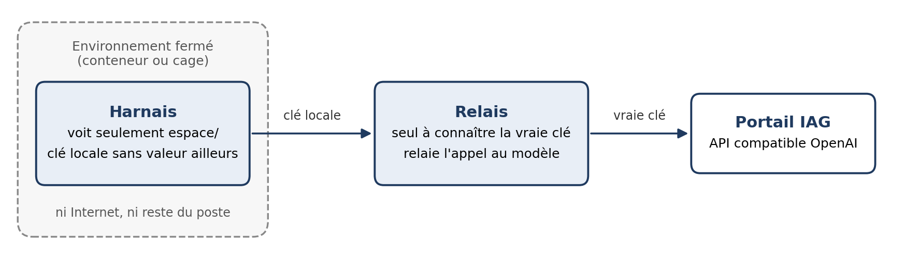

**Sommaire**

1. [Le principe](#principe) : pourquoi et comment on enferme un harnais d'agent
2. [Mettre en place l'environnement fermé](#installation) : une option au choix selon le poste
    - 2.1 [Fichiers communs aux trois options](#communs)
    - 2.2 [Option A : Docker](#docker)
    - 2.3 [Option B : Podman](#podman)
    - 2.4 [Option C : sans conteneur (bubblewrap)](#bubblewrap)
3. [Contrôler que l'environnement est bien fermé](#controler) : cinq contrôles avant le premier lancement
4. [Relier le harnais au modèle du portail IAG](#relier) : installation et configuration de Goose, OpenCode, gptme, Cline, Pi ou d'un autre harnais
5. [Ce que l'environnement fermé ne couvre pas](#limites)

# 1. Le principe {#principe}

Un harnais d'agent (Goose, OpenCode, gptme, Pi, Cline…) exécute les commandes que décide un modèle de langage : lire, écrire, effacer, installer. Le modèle peut se tromper, ou obéir à une consigne cachée dans un document qu'il lit. On ne cherche donc pas à faire confiance au harnais : on borne ce qu'il peut atteindre.

{width=15cm}

| Protection | Risque évité | Comment |
|---|---|---|
| Le harnais est enfermé | effacement ou lecture du reste du poste (clés SSH, documents) | conteneur ou cage : seul le dossier `espace/` est visible, le système est en lecture seule |
| Le harnais n'a pas la vraie clé | clé du portail recopiée dans une trace ou un fichier, puis réutilisée | un relais garde la clé et donne au harnais une clé locale, sans valeur ailleurs |
| Le harnais n'a pas Internet | envoi de fichiers vers l'extérieur, téléchargement de code piégé | réseau coupé ; seul le relais vers le portail IAG est joignable |
| Le harnais n'a aucun droit d'administration | modification du système | utilisateur ordinaire, aucun privilège |
| Mémoire et processus plafonnés | poste saturé par un programme qui s'emballe | limites du conteneur ou de systemd |

# 2. Mettre en place l'environnement fermé {#installation}

Trois options pour enfermer le harnais, au choix selon ce que le poste permet. Les protections sont les mêmes. Toutes commencent par les fichiers communs (2.1).

| Option | À choisir si | Partie |
|---|---|---|
| A. Docker | `docker compose version` répond | 2.2 |
| B. Podman | `podman --version` répond, ou Podman peut être installé | 2.3 |
| C. Sans conteneur (bubblewrap) | ni Docker ni Podman | 2.4 |

## 2.1 Fichiers communs aux trois options {#communs}

Créer un dossier de travail et y placer les deux fichiers suivants.

```bash
mkdir -p harnais-securise/espace && cd harnais-securise
```

**`relais.py`** : le seul programme qui connaît la clé du portail IAG. Il vérifie la clé locale du harnais, remplace celle-ci par la vraie clé et transmet l'appel au portail. Il ne relaie que l'appel au modèle.

{{code:relais.py:python}}

**`.env`** : les réglages. La commande crée aussi la clé locale. Ce fichier contient la clé du portail : ne jamais le partager.

```bash
cat > .env <<EOF
IAG_URL=https://<adresse du portail IAG>/v1
IAG_CLE=<clé personnelle du portail>
IAG_MODELE=<nom exact du modèle>
CLE_LOCALE=relais-$(openssl rand -hex 16)
UID_AGENT=$(id -u)
EOF
chmod 600 .env
```

Seul ce que l'on dépose dans `espace/` est visible du harnais, et peut donc partir au portail IAG.

## 2.2 Option A : Docker {#docker}

**`Dockerfile`** : l'image du harnais. Seule la ligne d'installation change d'un harnais à l'autre (partie 4).

{{code:Dockerfile:dockerfile}}

**`compose.yaml`** : le relais et le harnais. Le réseau `interne` n'a aucune route vers l'extérieur ; seul le relais est aussi branché sur le réseau `sortie`.

{{code:compose.yaml:yaml}}

Construire, démarrer le relais, puis ouvrir un terminal dans le harnais :

```bash
docker compose build
docker compose up -d relais
docker compose run --rm harnais
```

Le terminal s'ouvre dans `/travail`, qui est le dossier `espace/` du poste. Faire les contrôles (partie 3), puis relier le harnais au modèle (partie 4). Arrêter : `docker compose down`.

## 2.3 Option B : Podman {#podman}

Installer Podman s'il manque (Ubuntu) :

```bash
sudo apt install podman podman-compose
```

Mêmes fichiers que pour l'option A, avec une ligne en plus dans `compose.yaml`, sous `harnais:`. Sans elle, Podman décale les numéros d'utilisateur et le harnais ne peut pas écrire dans `espace/`.

```yaml
  harnais:
    userns_mode: keep-id
```

Puis les mêmes commandes, avec `podman compose` :

```bash
podman compose build
podman compose up -d relais
podman compose run --rm harnais
```

Le terminal s'ouvre dans `/travail`, qui est le dossier `espace/` du poste. Faire les contrôles (partie 3), puis relier le harnais au modèle (partie 4). Arrêter : `podman compose down`.

Avec la version de podman-compose fournie par Ubuntu 24.04 (1.0.6), la limite du nombre de processus (`pids_limit`) n'est pas appliquée ; la limite de mémoire l'est.

## 2.4 Option C : sans conteneur (bubblewrap) {#bubblewrap}

bubblewrap enferme un programme avec les mêmes mécanismes du noyau qu'un conteneur, sans image ni service. socat sert de passage unique entre la cage et le relais.

```bash
sudo apt install bubblewrap socat
```

Créer les dossiers du harnais et y installer le harnais (exemple : Goose ; autres harnais en partie 4) :

```bash
mkdir -p maison harnais/bin
curl -fsSL https://github.com/aaif-goose/goose/releases/download/v1.60.1/goose-x86_64-unknown-linux-gnu.tar.gz \
  | tar -xz -C harnais/bin ./goose
```

**Terminal 1 : le relais**, sur une socket privée :

```bash
mkdir -p "$XDG_RUNTIME_DIR/harnais" && chmod 700 "$XDG_RUNTIME_DIR/harnais"
set -a; . ./.env; set +a
ECOUTE="$XDG_RUNTIME_DIR/harnais/relais.sock" python3 relais.py
```

**Terminal 2 : la cage**, depuis le même dossier :

{{code:cage.sh:bash}}

Le terminal s'ouvre dans la cage, dans `/travail`, qui est le dossier `espace/` du poste. Faire les contrôles (partie 3), puis relier le harnais au modèle (partie 4). Arrêter : `exit`.

Ce que fait chaque élément de la commande :

| Élément | Effet |
|---|---|
| `systemd-run … MemoryMax=8G TasksMax=2048` | plafonne la mémoire et le nombre de processus |
| `--unshare-all` | réseau, processus et utilisateurs propres à la cage : aucun accès à Internet |
| `--ro-bind /usr`, `/etc` | système du poste visible, en lecture seule |
| `--tmpfs /home`, `--bind espace /travail` | dossier personnel du poste invisible ; seul `espace/` est visible et modifiable |
| `--clearenv`, `--setenv` | environnement vide, puis seulement l'adresse du relais, la clé locale et le modèle |
| `socat …` | dans la cage, le port 8080 mène au relais, et à rien d'autre |

Sur Ubuntu 24.04, bubblewrap peut s'arrêter sur `setting up uid map: Permission denied`. Ubuntu fournit l'autorisation nécessaire sans l'activer ; pour l'activer (une fois par poste) :

```bash
sudo apt install apparmor-profiles
sudo cp /usr/share/apparmor/extra-profiles/bwrap-userns-restrict /etc/apparmor.d/
sudo apparmor_parser -r /etc/apparmor.d/bwrap-userns-restrict
```

# 3. Contrôler que l'environnement est bien fermé {#controler}

Avant le premier lancement du harnais, coller ces lignes dans le terminal ouvert à la fin de l'option choisie (conteneur ou cage). Elles vérifient que le harnais n'a ni Internet, ni la vraie clé, ni accès au reste du poste, et que le modèle répond par le relais.

{{code:controles.sh:bash}}

Résultat attendu :

- `OK : pas d'Internet` ;
- `OK : clé du portail absente` ;
- dossiers personnels visibles : `agent` seulement ;
- fausse clé : `401` ;
- une réponse du modèle (JSON avec `"content"`).

Ne pas lancer le harnais si un résultat diffère.

# 4. Relier le harnais au modèle du portail IAG {#relier}

Le harnais a besoin d'un modèle de langage pour décider de ses actions : ici, le modèle du portail IAG, joint par le relais. Dans le terminal du harnais, trois variables sont déjà définies : `OPENAI_BASE_URL` (adresse du relais), `OPENAI_API_KEY` (clé locale) et `MODELE` (nom du modèle). Il suffit de les donner au harnais, comme pour n'importe quel fournisseur compatible OpenAI. Pour chaque harnais : la ligne d'installation, à placer dans le `Dockerfile` à la place de celle de Goose, puis la configuration, à taper dans le terminal du harnais.

## 4.1 Goose 1.60.1

Installation : déjà dans le `Dockerfile` d'exemple. Configuration :

```bash
export GOOSE_PROVIDER=openai OPENAI_HOST="${OPENAI_BASE_URL%/v1}" OPENAI_BASE_PATH=v1/chat/completions \
       GOOSE_MODEL="$MODELE" GOOSE_MODE=auto GOOSE_DISABLE_KEYRING=1
goose session
```

## 4.2 OpenCode 1.19.6

```dockerfile
RUN curl -fsSL https://github.com/anomalyco/opencode/releases/download/v1.19.6/opencode-linux-x64.tar.gz \
  | tar -xz -C /usr/local/bin
```

```bash
mkdir -p ~/.config/opencode && cat > ~/.config/opencode/opencode.json <<EOF
{"model": "iag/$MODELE", "small_model": "iag/$MODELE", "autoupdate": false, "share": "disabled",
 "provider": {"iag": {"npm": "@ai-sdk/openai-compatible", "name": "Portail IAG",
   "options": {"baseURL": "$OPENAI_BASE_URL", "apiKey": "{env:OPENAI_API_KEY}"},
   "models": {"$MODELE": {"name": "$MODELE", "tool_call": true}}}},
 "permission": {"edit": "allow", "bash": "allow", "webfetch": "deny"}}
EOF
opencode
```

## 4.3 gptme 0.37.0

```dockerfile
RUN pip install gptme==0.37.0
```

```bash
mkdir -p ~/.config/gptme && cat > ~/.config/gptme/config.toml <<EOF
[[providers]]
name = "iag"
base_url = "$OPENAI_BASE_URL"
api_key_env = "OPENAI_API_KEY"
default_model = "$MODELE"
EOF
export GPTME_TIKTOKEN_TIMEOUT=0 GPTME_NO_LOCAL_DISCOVERY=1
gptme --tool-format tool -m "iag/$MODELE"
```

## 4.4 Cline 3.0.74 et Pi 1.5.2 (harnais Node)

Ajouter d'abord Node 24 au `Dockerfile`, puis le harnais :

```dockerfile
COPY --from=node:24-slim /usr/local/bin/node /usr/local/bin/node
COPY --from=node:24-slim /usr/local/lib/node_modules /usr/local/lib/node_modules
RUN ln -s ../lib/node_modules/npm/bin/npm-cli.js /usr/local/bin/npm
RUN npm install -g cline@3.0.74
```

```bash
cline auth -p openai-compatible -k "$OPENAI_API_KEY" -m "$MODELE" -b "$OPENAI_BASE_URL"
cline
```

Pour Pi : `RUN npm install -g @earendil-works/pi-coding-agent@1.5.2`, puis :

```bash
mkdir -p ~/.pi/agent && cat > ~/.pi/agent/models.json <<EOF
{"providers": {"iag": {"baseUrl": "$OPENAI_BASE_URL", "api": "openai-completions", "apiKey": "\$OPENAI_API_KEY",
  "models": [{"id": "$MODELE", "name": "$MODELE", "input": ["text"], "contextWindow": 128000, "maxTokens": 8192}]}}}
EOF
export PI_OFFLINE=1 PI_SKIP_VERSION_CHECK=1 PI_TELEMETRY=0
pi --provider iag --model "$MODELE"
```

## 4.5 Autre harnais

Configurer un « fournisseur compatible OpenAI » avec `$OPENAI_BASE_URL`, `$OPENAI_API_KEY` et `$MODELE`.

## 4.6 Installation avec l'option C (sans conteneur)

Le harnais s'installe sur le poste dans `harnais/` au lieu du `Dockerfile` : binaire dans `harnais/bin` (Goose, OpenCode) ; pour les harnais Node, Node.js doit être installé sur le poste.

# 5. Ce que l'environnement fermé ne couvre pas {#limites}

| Limite | Que faire |
|---|---|
| Tout ce que le harnais lit dans `espace/` peut partir au portail IAG | n'y déposer que des données autorisées pour le portail |
| Pas de plafond de consommation dans le relais | s'appuyer sur le quota de la clé côté portail IAG ; une clé personnelle par testeur |
| Pas d'Internet, donc pas d'installation de paquets pendant le test | installer à l'avance ce dont le harnais a besoin (dans l'image, ou dans `harnais/`) |
| Conteneur et cage partagent le noyau du poste | pour des données très sensibles : une machine virtuelle dédiée en plus |
| Le code produit par le harnais peut être faux ou dangereux | le relire avant de l'exécuter hors de l'environnement fermé |
