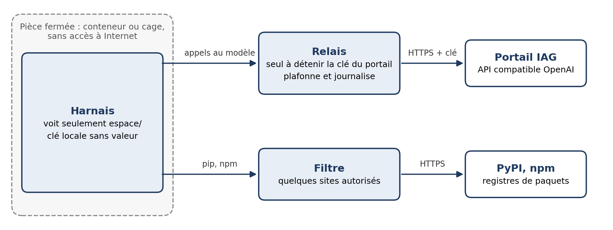

# Présentation

Ce document explique comment faire travailler un harnais d'agent (Goose, OpenCode, gptme, Pi, Cline ou un autre) sans risque pour le poste ni pour la clé du portail IAG. Le portail IAG est le « cerveau » du harnais : une API compatible OpenAI, qui s'utilise avec une adresse et une clé.

Il s'accompagne d'une archive de scripts, à télécharger depuis le même emplacement et à décompresser sur le poste. Les commandes de ce document se lancent depuis le dossier décompressé.

## Le principe

Un harnais exécute les commandes que décide un modèle de langage. Le modèle peut se tromper, ou obéir à une consigne cachée dans un document. Le kit ne fait donc pas confiance au harnais : il borne ce que le harnais peut atteindre.

{width=16cm}

- **Pièce fermée.** Le harnais ne voit que le dossier `espace/`. Le reste du poste lui est invisible.
- **Relais.** Il détient la clé du portail : le harnais ne la voit jamais. Il plafonne les jetons et le débit, et note chaque appel, sans le contenu.
- **Filtre.** C'est la seule sortie vers Internet, limitée aux sites de paquets.
- **Vérificateur.** Il contrôle 21 protections avant de commencer.

## Par où commencer

1. **Choisir le mode.** Lancer ces commandes sur le poste (Linux, ou WSL2 sous Windows) et prendre la première qui affiche une version. Si aucune ne répond, installer Podman ou bubblewrap : une commande sur Ubuntu, donnée au début des chapitres 3 et 4. Les protections sont les mêmes dans les trois modes.

   | Commande | Mode | Chapitre |
   |---|---|---|
   | `docker compose version` | Docker | 2 |
   | `podman --version` | Podman | 3 |
   | `bwrap --version` | Sans conteneur (bubblewrap) | 4 |

2. **Suivre le chapitre du mode choisi.** Compter environ 30 minutes : réglages, vérification, premier lancement.
3. **Brancher le harnais** avec le chapitre 5.

## Contenu du document

| Chapitre | À lire pour |
|---|---|
| 1. Principe et risques | comprendre les risques, chaque protection et ses limites |
| 2. Installation avec Docker | installer et utiliser le kit avec Docker |
| 3. Installation avec Podman | installer et utiliser le kit avec Podman |
| 4. Installation sans conteneur | installer et utiliser le kit sans conteneur |
| 5. Brancher un harnais | installer et configurer Goose, OpenCode, gptme, Pi, Cline ou un autre harnais |
| 6. Réglages | régler `.env` (portail, plafonds, proxy d'entreprise) et préparer les questions au portail |
| 7. Dépannage | corriger un problème ou une ligne `NON CONFORME` |
| 8. Organiser un test à plusieurs | répartir les clés, les réglages et la collecte des résultats |

## Contenu de l'archive de scripts

| Élément | Rôle |
|---|---|
| `.env.exemple`, `preparer.sh` | modèle des réglages ; script qui crée `.env` et la clé locale du relais |
| `relais/portail.py` | relais vers le portail IAG |
| `relais/filtre.py` | filtre des téléchargements |
| `verifier/verifier.py` | contrôle des 21 protections |
| `outils/bilan.py` | bilan de consommation : appels, jetons, refus |
| `outils/faux_portail.py` | faux portail, pour tout essayer sans clé |
| `compose.yaml`, `harnais/Dockerfile` | modes Docker et Podman : conteneurs et image du harnais |
| `compose.podman.yaml` | complément pour le mode Podman |
| `sans-conteneur/` | mode sans conteneur : lanceur et cage |

## Trois règles

- Ne déposer dans `espace/` que des données que le portail IAG a le droit de recevoir : tout ce que le harnais lit peut partir au modèle.
- Une clé personnelle du portail par testeur ; `.env` n'est jamais partagé ni versionné.
- Ne pas commencer de test tant que le vérificateur n'affiche pas `21 sur 21`.
